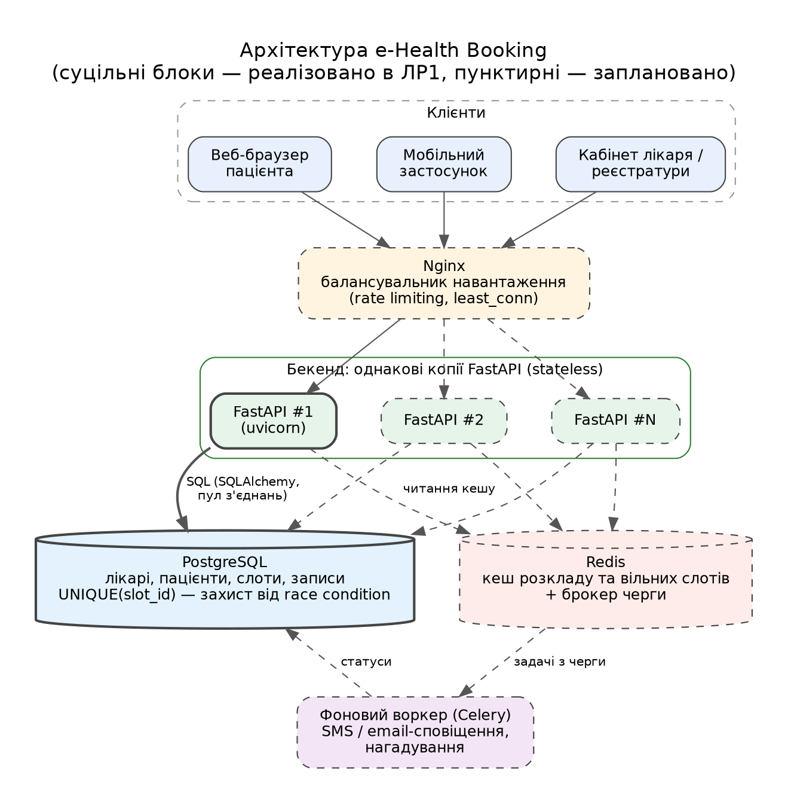

# e-Health Booking

[](https://github.com/aanastasiaakk/ehealth-python/actions/workflows/ci.yml)

Сервіс електронного запису до державних лікарів.
Навчальний проєкт з дисципліни «Розробка високонавантажених систем на Python».

**Сценарій навантаження:** о 8:00 одночасно відкриваються нові слоти до
вузьких спеціалістів, тисячі пацієнтів намагаються записатися в ту саму
секунду, і двоє не повинні отримати один і той самий слот.

## Документація

- [1. Вибір предметної області та обґрунтування](docs/01-choice.md)
- [2. Архітектура системи, модель даних, схеми](docs/02-architecture.md)
- [3. Демонстрація pre-commit хуків](docs/03-pre-commit.md)
- [4. ЛР2: користувачі, ролі, розмежування прав](docs/04-lab2-auth.md)
- [5. ЛР3: середовища sandbox / production, обробка помилок, CI](docs/05-lab3-environments.md)
- [6. ЛР4: навантажувальне тестування (Locust), метрики, вузькі місця](docs/06-lab4-load-testing.md)
- [7. ЛР5: контейнеризація (Docker, docker compose)](docs/07-lab5-docker.md)
- [8. ЛР6: балансування навантаження (Nginx, 3 репліки)](docs/08-lab6-load-balancing.md)
- [9. ЛР7: оптимізація (обмежувач запитів, Redis, індекси, ДО/ПІСЛЯ)](docs/09-lab7-optimization.md)



## Технології

| Що | Навіщо |
|---|---|
| Python 3.10+, **FastAPI**, uvicorn | веб-фреймворк і сервер |
| **PostgreSQL 16** (у Docker) | реляційна база даних |
| SQLAlchemy 2 + psycopg 3 | робота з базою з Python |
| pydantic-settings | налаштування з `.env` |
| PyJWT, bcrypt | токени входу та хешування паролів |
| Jinja2 | HTML-сторінки |
| **ruff**, **pre-commit** | контроль якості коду |
| pytest | тести |
| **Docker**, docker compose | контейнери: застосунок + бази однією командою |
| **Nginx** | балансувальник навантаження перед 3 репліками (ЛР6) |
| **Redis** | кеш каталогу лікарів і вільних слотів (ЛР7) |

## Структура проєкту

```
ehealth-booking/
├── app/                      # КОД застосунку
│   ├── main.py               #   точка входу: збирає всі частини разом
│   ├── config.py             #   налаштування (.env.sandbox / .env.production)
│   ├── errors.py             #   сторінки помилок 500/404 без стектрейсів
│   ├── database.py           #   підключення до PostgreSQL
│   ├── cache.py              #   кеш у Redis (ЛР7)
│   ├── limiter.py            #   обмеження одночасних запитів (ЛР7)
│   ├── models.py             #   таблиці бази даних
│   ├── schemas.py            #   формати даних API (що приймаємо / віддаємо)
│   ├── security.py           #   паролі (bcrypt) і токени (JWT)
│   ├── dependencies.py       #   хто ти? що тобі можна? (401 / 403)
│   ├── services/             #   бізнес-логіка
│   │   ├── users.py          #     реєстрація, перевірка пароля
│   │   └── booking.py        #     запис, скасування, слоти
│   ├── api/                  #   JSON API
│   │   ├── auth.py           #     /auth/register, /auth/token
│   │   ├── users.py          #     /users/me, /users/{id}
│   │   ├── catalog.py        #     /specialties, /doctors, слоти
│   │   ├── appointments.py   #     /appointments
│   │   ├── doctor.py         #     /doctor/schedule
│   │   ├── admin.py          #     /admin/...
│   │   └── health.py         #     /health, /health/db
│   ├── web/pages.py          #   HTML-сторінки
│   └── templates/            #   HTML-шаблони
├── scripts/seed.py           # початкові дані (демо-дані лише в sandbox)
├── scripts/migrate.py        # таблиці й індекси (у Docker — сервіс migrate)
├── scripts/explain_analyze.py # EXPLAIN ANALYZE до/після індексів (ЛР7)
├── scripts/seed_loadtest.py  # 200 тестових пацієнтів і слоти для ЛР4
├── loadtest/                 # НАВАНТАЖУВАЛЬНЕ ТЕСТУВАННЯ (ЛР4)
│   ├── locustfile.py         #   сценарій Locust і профіль навантаження
│   ├── monitor.py            #   збір CPU/RAM сервера під час тесту
│   ├── make_report.py        #   графіки й таблиці для звіту
│   └── results/              #   сирі результати прогонів (CSV)
├── tests/                    # ТЕСТИ (102 шт.)
├── .github/workflows/ci.yml  # CI: лінтери + тести на кожен Pull Request
├── docs/                     # ДОКУМЕНТАЦІЯ та схеми
├── config/nginx/             # Nginx: шаблон балансувальника + алгоритми (ЛР6)
├── Dockerfile                # образ застосунку (multi-stage, ЛР5)
├── .dockerignore             # що не потрапляє в образ (секрети, .git, кеш)
├── docker-compose.yml        # уся система: бази, міграції, застосунок
├── docker-compose.dev.yml    # режим розробки: hot reload у контейнері
├── .env.*.example            # шаблони налаштувань середовищ
├── requirements*.txt         # залежності
├── pyproject.toml            # налаштування ruff і pytest
└── .pre-commit-config.yaml   # pre-commit хуки
```

## Як запустити (macOS)

Застосунок має два середовища з **окремими базами даних**:

| | Sandbox (тестове) | Production (робоче) |
|---|---|---|
| Файл налаштувань | `.env.sandbox` | `.env.production` |
| База даних | `db-sandbox`, порт 5433 | `db-production`, порт 5434 |
| DEBUG | `true` (детальні помилки) | `false` (примусово) |
| Swagger `/docs` | є | вимкнено |
| Демо-акаунти | є | немає, лише адмін |

### Крок 0. Один раз: залежності та файли налаштувань

```bash
python3 -m venv .venv
source .venv/bin/activate
pip install -r requirements-dev.txt
pre-commit install

cp .env.example .env                        # паролі баз для docker compose
cp .env.sandbox.example .env.sandbox        # налаштування sandbox
cp .env.production.example .env.production  # налаштування production
```

Відкрий `.env` і `.env.production` та заміни всі `CHANGE-ME`:
- `POSTGRES_PASSWORD_PROD` у `.env` і пароль у `DATABASE_URL` у
  `.env.production` мають **збігатися**;
- новий `SECRET_KEY`: `python3 -c "import secrets; print(secrets.token_hex(32))"`;
- надійний `ADMIN_PASSWORD`.

Ці файли не потрапляють у Git: у репозиторії лише шаблони `*.example`.

### Крок 1. Бази даних (Docker Desktop має бути запущений)

```bash
docker compose up -d db-sandbox db-production   # лише бази: 5433 і 5434
docker compose ps                               # обидві мають бути (healthy)
```

> Уся система в Docker (бази + міграції + застосунок на :8080) —
> `docker compose up --build`, див. розділ «Docker» нижче.

### Sandbox: розробка і тестування

```bash
APP_ENV=sandbox python -m scripts.seed                   # адмін + демо-лікарі, пацієнт, слоти
APP_ENV=sandbox uvicorn app.main:app --reload --port 8000
```

Відкрий http://127.0.0.1:8000. Демо-акаунти sandbox:

| Роль | Email | Пароль |
|---|---|---|
| Адміністратор | admin@ehealth.ua | admin12345 |
| Лікар | kovalenko@ehealth.ua | doctor12345 |
| Пацієнт | patient@ehealth.ua | patient12345 |

Swagger: http://127.0.0.1:8000/docs (кнопка **Authorize** → email у полі
`username`).

### Production: робоче середовище

```bash
APP_ENV=production python -m scripts.seed                    # лише адмін
APP_ENV=production uvicorn app.main:app --port 8001 --workers 2
```

Відкрий http://127.0.0.1:8001. Увійти можна адміном з паролем, який ти
вказала в `.env.production`. Демо-акаунтів тут немає: це інша база.
`--reload` у production не використовується, а `--workers 2` запускає
дві копії застосунку.

Перевірити, яке середовище працює: http://127.0.0.1:8001/health →
`{"status":"ok","environment":"production"}`.

Якщо production не запускається з помилкою `Unsafe production config`,
значить у `.env.production` лишилась заглушка або `DEBUG=true`: так і
задумано.

## Основні маршрути API

| Метод і шлях | Хто має доступ |
|---|---|
| `POST /auth/register`, `POST /auth/token` | усі |
| `GET /specialties`, `GET /doctors`, `GET /doctors/{id}/slots` | усі |
| `GET /users/me` | будь-хто після входу |
| `GET/PATCH /users/{id}` | власник або адмін |
| `POST /appointments`, `GET /appointments/me` | пацієнт |
| `GET /appointments/{id}` | власник, його лікар, адмін |
| `DELETE /appointments/{id}` | власник або адмін |
| `GET /doctor/schedule` | лікар |
| `/admin/*` (статистика, користувачі, ролі, лікарі, слоти) | адмін |

## Тести та якість коду

```bash
docker compose up -d db-sandbox   # тестам потрібна лише sandbox-база
pytest                            # усі тести (вони завжди йдуть у sandbox)
pytest -v tests/test_access.py    # лише тести розмежування прав, детально
ruff check .                      # лінтер
ruff format .                     # форматування
pre-commit run --all-files        # всі перевірки, як перед комітом
```

Тести створюють окрему базу `ehealth_sandbox_test`, тому не чіпають
ні демо-дані sandbox, ні production.

## Навантажувальне тестування (Locust)

Повний звіт з метриками, графіками й вузькими місцями:
[docs/06-lab4-load-testing.md](docs/06-lab4-load-testing.md).

```bash
pip install -r requirements-loadtest.txt
APP_ENV=sandbox python -m scripts.seed_loadtest        # 200 тестових пацієнтів
APP_ENV=sandbox DEBUG=false uvicorn app.main:app --port 8000
locust -f loadtest/locustfile.py --host http://127.0.0.1:8000   # → http://localhost:8089
```

Коротко: у ЛР4 на ~320 користувачах вичерпувався пул з'єднань з БД і
сервер переставав відповідати. Після оптимізацій ЛР7 (обмежувач
запитів, кеш Redis, частковий індекс) той самий один процес тримає 600
користувачів: 323 RPS, p95 71 мс, 0 помилок
([docs/09-lab7-optimization.md](docs/09-lab7-optimization.md)).

Локально кеш вмикається змінною `REDIS_URL=redis://localhost:6379/0`
(Redis: `brew install redis && brew services start redis`); без неї
застосунок працює без кешу.

## CI/CD (GitHub Actions)

Файл `.github/workflows/ci.yml`. При кожному Pull Request і push у `main`
GitHub автоматично:
1. перевіряє код лінтером ruff (помилки й форматування);
2. піднімає тимчасовий PostgreSQL і запускає всі тести pytest.

Результат — у вкладці **Actions** репозиторію та в самому Pull Request.

## Якщо лишились бази з ЛР1–ЛР2

У ЛР3 з'явилися дві нові бази на портах 5433 і 5434. Стара база з
попередніх лаб (порт 5432) більше не потрібна:

```bash
docker rm -f ehealth-db   # видалити старий контейнер з ЛР1–ЛР2
docker compose up -d
```

## Docker (уся система однією командою)

Повний опис: [docs/07-lab5-docker.md](docs/07-lab5-docker.md).

```bash
docker compose up --build            # бази → міграції + seed → застосунок
```

Відкрий http://127.0.0.1:8080 (демо-акаунти ті самі, що в sandbox).
Запити приймає Nginx і розподіляє між 3 репліками застосунку (ЛР6);
яка репліка відповіла — видно в заголовку `X-Instance`.

```bash
bash scripts/lab5_docker_check.sh    # автоматична перевірка всього (ЛР5)
bash scripts/lab6_balancer_check.sh  # Round Robin, збій репліки, least_conn (ЛР6)
docker compose -f docker-compose.yml -f docker-compose.dev.yml up --build   # hot reload
docker compose down                  # зупинити (дані баз зберігаються)
```
