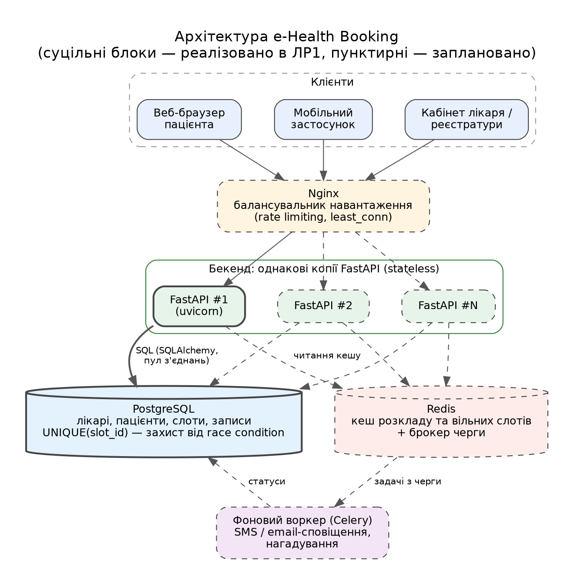
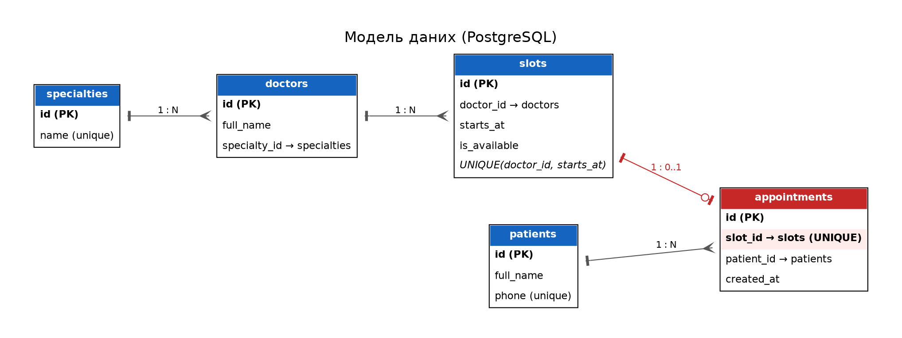
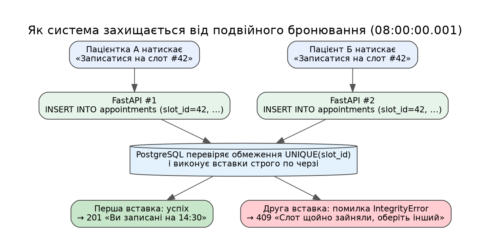

# 2. Архітектура системи

Суцільні блоки реалізовано в ЛР1, пунктирні заплановано на наступні
лабораторні роботи. Вихідні файли схем лежать у `docs/diagrams/*.dot`
(формат Graphviz).

## Компоненти та їх взаємодія

| Компонент | Роль | Статус |
|---|---|---|
| **Клієнти** (браузер, мобільний застосунок, кабінет лікаря) | Надсилають HTTP-запити до API й показують результат | зовнішні |
| **Nginx** | Єдина точка входу. Розподіляє запити між копіями бекенду (`least_conn`), обмежує частоту запитів від одного клієнта (rate limiting) | заплановано |
| **FastAPI** (uvicorn) | Бізнес-логіка: перегляд слотів, бронювання, скасування. Копії **stateless** (не зберігають стан між запитами), тому їх можна додавати скільки завгодно | **реалізовано** (одна копія) |
| **PostgreSQL** | Головне надійне сховище. Гарантує цілісність даних через обмеження `UNIQUE` та транзакції | **реалізовано** |
| **Redis** | Кеш розкладу й вільних слотів (знімає з бази основне read-навантаження), брокер черги задач | заплановано |
| **Фоновий воркер** (Celery) | Надсилає сповіщення й нагадування, не затримуючи відповідь користувачу | заплановано |

## Шлях типового запиту

**Перегляд вільних слотів (read):**
клієнт → Nginx → FastAPI → Redis (якщо є в кеші — відповідь одразу) →
інакше PostgreSQL → результат кладемо в Redis на кілька секунд → клієнт.

**Бронювання слоту (write):**
клієнт → Nginx → FastAPI → транзакція в PostgreSQL (`INSERT` в
`appointments`) → успіх `201` або конфлікт `409` → FastAPI кладе задачу
«надіслати SMS» у чергу → воркер надсилає SMS у фоні.

## Модель даних

- Один лікар має одну спеціальність і багато слотів.
- Один слот може мати **не більше одного** запису: це забезпечує
  обмеження `UNIQUE(slot_id)` у таблиці `appointments`.
- Лікар не може мати два слоти на той самий час: `UNIQUE(doctor_id, starts_at)`.

## Захист від race condition

Перевірка «чи вільний слот» лише в коді Python ненадійна: два запити
можуть одночасно побачити «вільно» і обидва створити запис. Тому
остаточне рішення ухвалює база даних: обмеження `UNIQUE` фізично не дає
вставити другий рядок з тим самим `slot_id`. Бекенд перехоплює помилку
`IntegrityError` і повертає користувачу `409 Conflict`.

## Ключові рішення для витримки піку о 8:00

1. **Горизонтальне масштабування бекенду:** stateless-копії FastAPI за Nginx.
2. **Пул з'єднань до БД** (SQLAlchemy `pool_size` / `max_overflow`):
   з'єднання перевикористовуються, а не відкриваються на кожен запит.
3. **Кеш читань у Redis:** більшість запитів о 8:00 — це перегляд розкладу.
4. **Цілісність на рівні БД** (`UNIQUE`, транзакції) замість перевірок у коді.
5. **Асинхронні сповіщення** через чергу, щоб не сповільнювати бронювання.
6. **Rate limiting** на Nginx від ботів та «вічного F5».
