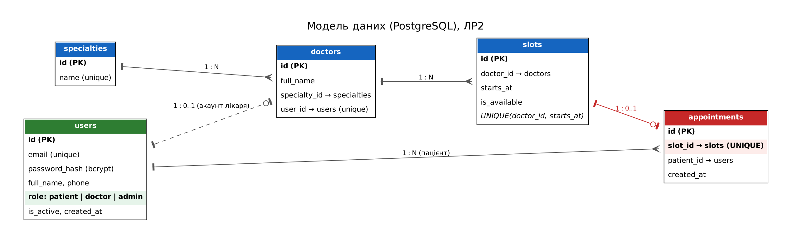
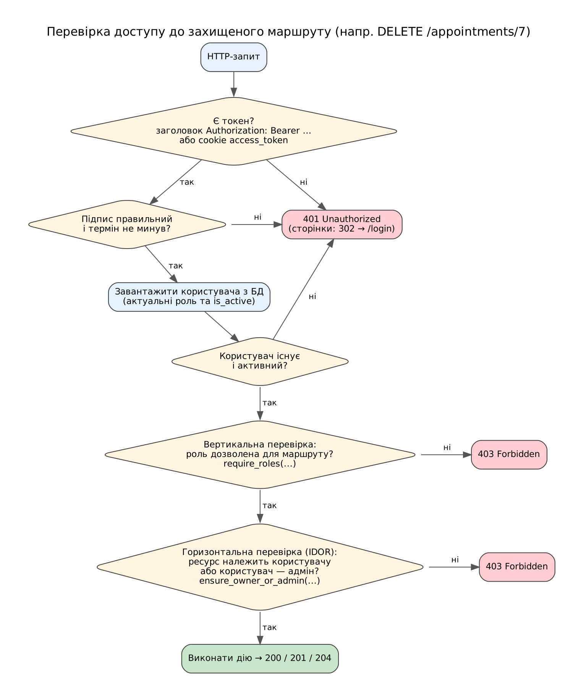

# 4. ЛР2: користувачі, ролі та розмежування прав доступу

## Що зроблено

| Завдання | Реалізація |
|---|---|
| База даних користувачів | таблиця `users` (email, хеш пароля, ім'я, телефон, роль, is_active) |
| Ролі (мінімум 2) | **3 ролі**: `patient` (звичайний користувач), `doctor`, `admin` |
| Реєстрація звичайних користувачів | `POST /auth/register` (API) і сторінка `/register` |
| Вхід для різних ролей | `POST /auth/token` (API, JWT) і сторінка `/login` (cookie) |
| Домашні сторінки ролей | `/patient`, `/doctor`, `/admin`; `/home` перенаправляє на свою |
| MVP (+2) | пошук лікаря, вільні слоти, запис, скасування, розклад лікаря, адмінка |
| Тести (+3) | 86 тестів pytest: юніт + інтеграційні, усі 4 обов'язкові сценарії |

## Модель даних

Таблицю `patients` з ЛР1 замінено загальною таблицею `users`:

- Пацієнт, лікар і адміністратор мають однакові базові дані (email,
  пароль, ім'я) та однаковий механізм входу. Окремі таблиці для кожної
  ролі означали б три копії логіки входу.
- Роль — це одна колонка `role`. Щоб додати нову роль (наприклад,
  «реєстратор»), достатньо додати значення в `Role`, а не нову таблицю.
- Специфічні дані лікаря (спеціальність, слоти) лишились у `doctors`,
  яка посилається на `users` через `user_id`.

## Перевірка доступу

## Обґрунтування архітектурних рішень

### 1. JWT-токени замість серверних сесій

Після входу сервер видає підписаний токен (JWT), і клієнт додає його до
кожного запиту. Серверу **не потрібно зберігати сесії** ні в пам'яті, ні
в базі: будь-яка копія бекенду може сама перевірити підпис токена.

Для нашої архітектури це ключове: за Nginx працюватиме кілька однакових
копій FastAPI. Із серверними сесіями в пам'яті користувач, що увійшов
через копію №1, був би «невідомим» для копії №2. JWT зберігає бекенд
**stateless**, тож копії можна додавати під пік о 8:00 без жодних змін.

### 2. Роль і статус беруться з бази, а не з токена

У токені зберігається лише `id` користувача. При кожному запиті
`get_optional_user` завантажує користувача з бази. Ціна — один простий
запит за первинним ключем. Виграш — якщо адміністратор змінить роль чи
заблокує користувача, це подіє **одразу**, а не після закінчення терміну
токена (тести `test_role_change_applies_immediately` і
`test_blocked_user_token_stops_working`). У наступних лабах цей запит
можна кешувати в Redis.

### 3. Два способи передати токен: заголовок і cookie

- **API** (`/auth/token`, `/appointments`, ...) — заголовок
  `Authorization: Bearer <token>`. Стандарт для мобільних застосунків і
  Swagger. Анонім отримує **401**.
- **HTML-сторінки** — cookie `access_token` з прапорцями `HttpOnly`
  (JavaScript не може вкрасти токен) та `SameSite=Lax` (базовий захист від
  CSRF). Анонім отримує **302 → /login**, бо людині в браузері потрібна
  форма входу, а не JSON з помилкою.

Обидва способи обробляє **одна** функція `get_optional_user`, тому правила
доступу однакові для API і сторінок.

### 4. RBAC: перевірки доступу як залежності FastAPI

- **Вертикальне розмежування** (`require_roles(Role.ADMIN)`) —
  перевірка ролі. Для адмінки підключено **на рівні всього роутера**, тому
  неможливо додати новий адмінський ендпоінт і «забути» його захистити.
- **Горизонтальне розмежування** (`ensure_owner_or_admin`) — захист від
  IDOR: пацієнт може змінювати лише свій профіль і скасовувати лише свої
  записи, навіть якщо підставить у URL чужий id.
- `patient_id` при записі **береться з токена**, а не з тіла запиту, тому
  записати іншу людину неможливо в принципі.
- Реєстрація завжди створює роль `patient`; поле `role` у запиті
  ігнорується. Адміністратора створює скрипт `scripts/seed.py`, лікарів —
  адміністратор через `POST /admin/doctors`.

### 5. Безпечне зберігання паролів

Паролі зберігаються як хеші **bcrypt** з випадковою сіллю: навіть маючи
копію бази, відновити паролі неможливо, а однакові паролі мають різні
хеші. Помилка входу однакова для «немає такого email» і «неправильний
пароль», щоб не можна було перевірити, хто зареєстрований.

### 6. Шар сервісів

Бізнес-логіку (`app/services/`) відокремлено від HTTP-обробників
(`app/api/`, `app/web/`). Ту саму функцію `book_slot` використовують API,
HTML-форма, скрипт seed і тести. Це спрощує тестування і дозволить у
майбутньому винести частину логіки у фоновий воркер.

### 7. Захист від race condition при бронюванні

`book_slot` використовує два рівні захисту:
1. `SELECT ... FOR UPDATE` блокує рядок слоту на час транзакції: друга
   одночасна транзакція чекає і бачить, що слот уже зайнятий;
2. обмеження `UNIQUE(slot_id)` — «останній рубіж» на рівні бази.

Тест `test_race_condition_only_one_booking_wins` запускає 20 одночасних
бронювань одного слоту в окремих потоках: успішне рівно одне.

## Тести

| Файл | Тип | Що перевіряє |
|---|---|---|
| `test_security.py` | юніт | хешування, JWT (прострочений, підроблений, чужий ключ), правила доступу |
| `test_auth.py` | інтеграційні | **сценарії 1–2**: анонім → 401 / 302, реєстрація, вхід 200, помилки входу 401 |
| `test_access.py` | інтеграційні | **сценарії 3–4**: пацієнт/лікар в адмінці → 403, IDOR → 403 |
| `test_booking.py` | інтеграційні | запис, 409 на зайнятий слот, скасування, **race condition** |

Тести працюють з окремою базою `ehealth_test`, яка створюється
автоматично й очищується перед кожним тестом.

Перевірено також «від зворотного»: якщо тимчасово вимкнути перевірку
власника, падає 7 тестів, а якщо вимкнути перевірку ролі — 15. Тобто
тести справді ловлять ці вразливості.
