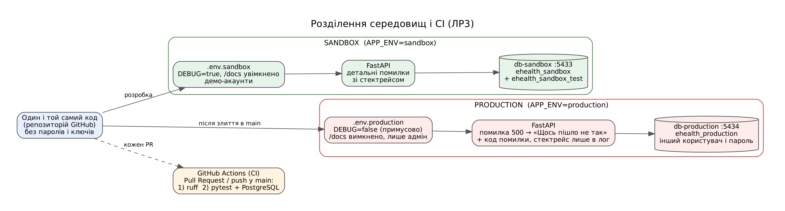

# 5. ЛР3: розділення середовищ і CI/CD



## Що зроблено

| Завдання | Реалізація |
|---|---|
| 1. Конфігурації через змінні оточення | `app/config.py` (pydantic-settings): файл обирається за `APP_ENV` → `.env.sandbox` або `.env.production`. У коді немає паролів, ключів і адрес БД |
| 2. Ізоляція баз даних | два окремі контейнери PostgreSQL: `db-sandbox` (порт 5433) і `db-production` (порт 5434) з різними користувачами, паролями й томами |
| 3. Режими безпеки | у production `DEBUG=false` примусово, `/docs` вимкнено, помилка 500 показує лише «Щось пішло не так» + код помилки |
| 4. Документування | README: інструкція запуску в обох середовищах |
| Додатково, варіант A | GitHub Actions: ruff + pytest з PostgreSQL на кожен PR і push у `main` |

## 1. Конфігурації без hardcoded-секретів

**Як було в ЛР2:** у `config.py` були значення за замовчуванням для
адреси БД, секретного ключа JWT і пароля адміна. Якщо забути `.env`,
застосунок тихо запускався з відомим усім паролем.

**Як стало:**

- `DATABASE_URL` і `SECRET_KEY` — **обов'язкові** поля без значень за
  замовчуванням. Без них застосунок не запускається і пише, чого бракує.
- Файл налаштувань обирається змінною `APP_ENV`:

  | APP_ENV | Файл | Для чого |
  |---|---|---|
  | `sandbox` (за замовчуванням) | `.env.sandbox` | розробка, тестування, демо |
  | `production` | `.env.production` | робоче середовище |

- Пріоритет: справжні змінні оточення → файл `.env.<середовище>` →
  несекретні значення за замовчуванням у коді. Тому на сервері чи в CI
  можна взагалі обійтися без файлів, лише змінними оточення.
- У Git потрапляють лише **шаблони** `.env.sandbox.example` і
  `.env.production.example`. Справжні `.env.*` виключено в `.gitignore`.
- Паролі баз для Docker теж не в `docker-compose.yml`, а у файлі `.env`
  (шаблон `.env.example`). Без пароля production-база навіть не стартує.

## 2. Ізоляція баз даних

| | Sandbox | Production |
|---|---|---|
| Контейнер | `ehealth-db-sandbox` | `ehealth-db-production` |
| Порт | 5433 | 5434 |
| Користувач БД | `ehealth_sandbox` | `ehealth_prod` |
| База | `ehealth_sandbox` | `ehealth_production` |
| Том даних | `pgdata-sandbox` | `pgdata-production` |
| Демо-дані (`scripts/seed.py`) | адмін, 4 лікарі, пацієнт, 160 слотів | **лише адмін** |

Це різні сервери з різними обліковими даними, тому з налаштувань
sandbox фізично неможливо під'єднатися до production-бази. Додаткові
запобіжники:

- production відмовиться запускатися, якщо `DATABASE_URL` вказує на
  sandbox-базу;
- тести (`tests/conftest.py`) завжди працюють у sandbox з окремою базою
  `ehealth_sandbox_test` і зупиняються, якщо бачать production-базу;
- `scripts/seed.py` у production не створює демо-акаунтів із відомими
  паролями та не друкує пароль адміна.

Перевірено: після seed у sandbox 6 користувачів, у production лише 1
(адмін). Вхід демо-пацієнтом у sandbox успішний, у production — 401.

## 3. Режими безпеки

### DEBUG у production

`app/config.py` перевіряє production-налаштування при старті і **не дає
запуститися**, якщо:
- `DEBUG=true`;
- `DATABASE_URL` вказує на sandbox-базу;
- `SECRET_KEY` схожий на заглушку (`CHANGE-ME`, `dev-`, `sandbox-`)
  або коротший за 32 символи.

```
$ APP_ENV=production DEBUG=true uvicorn app.main:app
ValidationError: Unsafe production config: DEBUG must be false in production
```

Також у production вимкнено Swagger (`/docs` → 404), щоб не показувати
структуру API сторонім, і SQL-запити не друкуються в консоль.

### Обробка помилки 500

`app/errors.py` перехоплює будь-яку непередбачену помилку:

| Хто питає | Що отримує |
|---|---|
| Браузер | сторінка «Щось пішло не так» з кодом помилки, напр. `59f55f2d` |
| API-клієнт | `{"detail": "Internal server error", "error_id": "6f8a6f11"}` |
| Лог сервера | `ERROR ehealth: Unhandled error 6f8a6f11 on GET /doctors` + повний стектрейс |

Код помилки зв'язує те, що бачив користувач, з записом у лозі, тож
розробник знайде причину, а користувач не побачить жодних внутрішніх
деталей (шляхів до файлів, SQL, паролів).

Також додано сторінку 404 для браузера. Стандартні відповіді API
(401, 403, 409) не змінилися.

**Як продемонструвати:** запусти production, відкрий
http://127.0.0.1:8001/doctors, потім зупини базу
(`docker compose stop db-production`) і онови сторінку. Production
покаже «Щось пішло не так», а sandbox у такій самій ситуації з
`DEBUG=true` — детальну сторінку зі стектрейсом.

## 4. CI/CD (варіант A)

Файл `.github/workflows/ci.yml`. Запускається автоматично при
створенні або оновленні Pull Request і при push у `main`
(а також вручну з вкладки **Actions**).

```
Pull Request ──► job «Лінтери»  ──► job «Тести»
                 ruff check          PostgreSQL 16 (service-контейнер)
                 ruff format --check pip install -r requirements-dev.txt
                                     pytest -v  (усі тести ЛР2 + ЛР3)
```

- Якщо лінтер знайде помилку, тести навіть не запускаються (`needs: lint`).
- База для тестів — тимчасовий контейнер PostgreSQL, який GitHub
  створює для кожного запуску й видаляє після нього.
- Налаштування передаються змінними оточення (файлу `.env.sandbox`
  у CI немає). Це тимчасова база й ключ лише для тестів, справжніх
  секретів у пайплайні немає.
- Результат видно у вкладці **Actions** і прямо в Pull Request
  (зелена галочка або червоний хрестик біля коміту). Якщо в
  налаштуваннях репозиторію ввімкнути правило «Require status checks»,
  GitHub не дасть злити PR з червоним CI.

## Тести ЛР3

`tests/test_config.py` (16 тестів):
- без `DATABASE_URL` / `SECRET_KEY` застосунок не стартує;
- налаштування читаються з файлу середовища та зі змінних оточення;
- production відмовляється від `DEBUG=true`, sandbox-бази та ключа-заглушки;
- шаблон `.env.production.example` не містить справжніх секретів;
- помилка 500 не показує стектрейс ні в JSON, ні в HTML, але стектрейс
  з тим самим кодом є в лозі;
- 404-сторінка для браузера, стандартний JSON для API.

Разом з тестами ЛР2: **102 тести**.
