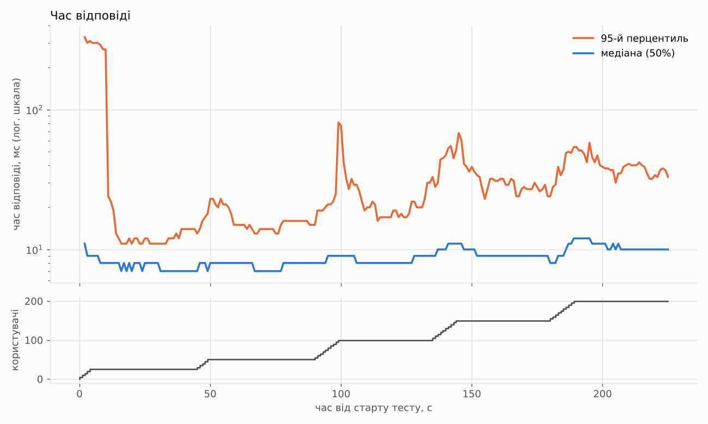
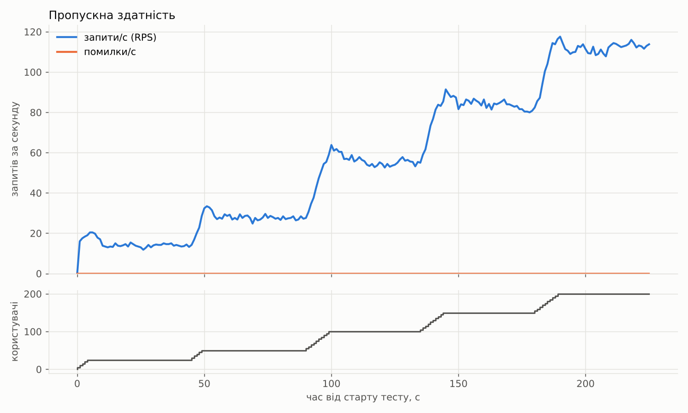
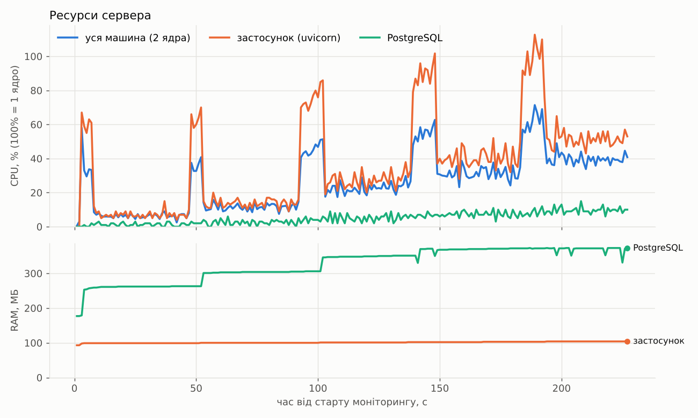
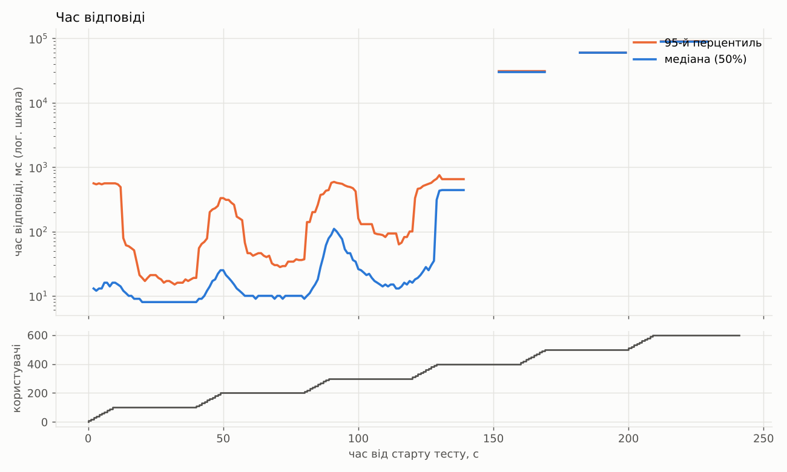
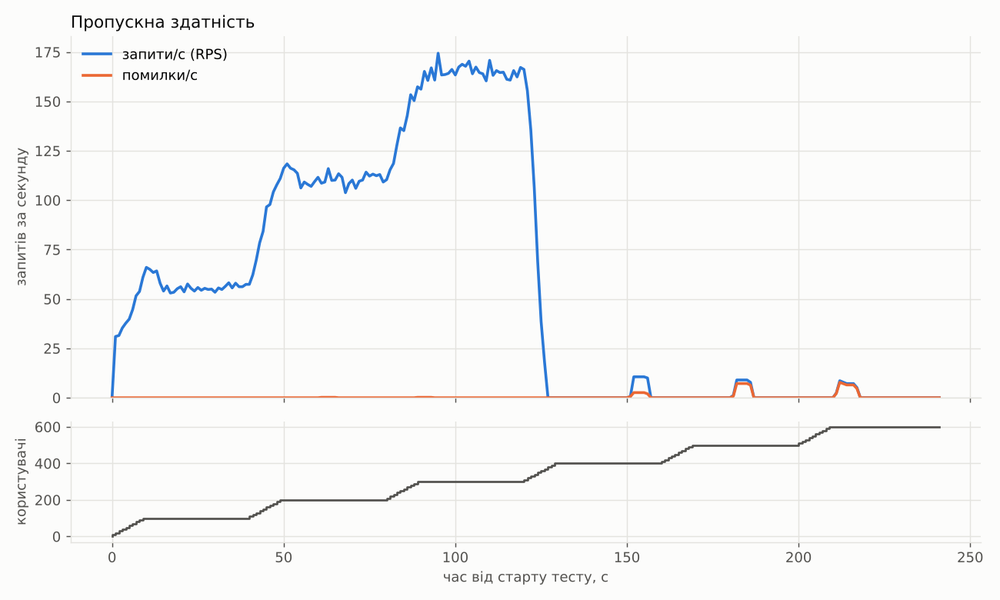
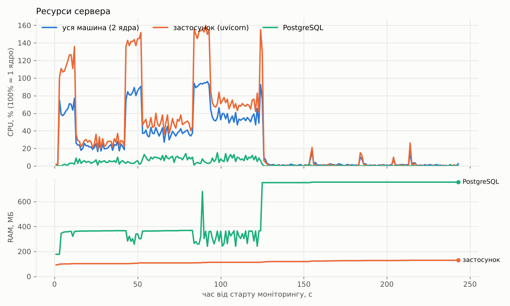

# 6. ЛР4: первинне навантажувальне тестування

## 1. Планування

### Інструмент: Locust

| Критерій | Чому Locust |
|---|---|
| Мова | сценарії пишуться на Python, як і весь проєкт |
| Реалістичність | кожен віртуальний користувач — окремий «сценарій» з паузами між діями, а не просто потік однакових запитів |
| Гнучкий профіль | розгін і сходинки описуються кодом (`LoadTestShape`) |
| Звітність | CSV з історією по секундах (для власних графіків) + HTML-звіт |
| Режими | веб-інтерфейс для ручного запуску і `--headless` для автоматизації |

JMeter потребує GUI і XML-сценаріїв, k6 — JavaScript, тому для
Python-проєкту Locust найпростіший у підтримці.

### Цільові ендпоінти MVP

Обрано запити, що реально йдуть о 8:00, коли відкриваються слоти:

| Ендпоінт | Хто викликає | Навіщо в тесті |
|---|---|---|
| `GET /` | усі | головна сторінка (HTML) |
| `GET /specialties`, `GET /doctors` | усі | каталог |
| `GET /doctors/{id}/slots` | усі | **найчастіший запит**: «чи є вільний час?» |
| `GET /health` | балансувальник | перевірка живучості |
| `POST /auth/token` | пацієнт | вхід (bcrypt — навмисно повільний) |
| `GET /appointments/me` | пацієнт | «мої записи» |
| `POST /appointments` | пацієнт | **запис на слот** (транзакція + блокування рядка) |
| `DELETE /appointments/{id}` | пацієнт | скасування |

### Профіль навантаження

| Параметр | Основний прогін (baseline) | Стрес-прогін |
|---|---|---|
| Віртуальні користувачі (VUsers) | сходинки 25 → 50 → 100 → 150 → 200 | 100 → 200 → 300 → 400 → 500 → 600 |
| Розгін (Ramp-Up) | 5 користувачів/с між сходинками | 10 користувачів/с |
| Тривалість сходинки | 45 с | 40 с |
| Загальна тривалість | ≈ 4 хв | ≈ 4 хв |
| Пауза користувача між діями | 1–3 с (`between(1, 3)`) | 1–3 с |
| Співвідношення типів | 60 % відвідувачі, 40 % пацієнти | так само |

Сходинки замість одного рівня дозволяють побачити, **з якої кількості
користувачів** система починає деградувати.

## 2. Сценарій і запуск

Файл `loadtest/locustfile.py`:

- **Visitor** (вага 3): відкриває головну, далі в циклі дивиться
  спеціальності, лікарів і вільні слоти випадкового лікаря.
- **Patient** (вага 2): входить під одним із 200 тестових акаунтів, далі
  дивиться слоти (5), свої записи (2), **записується** на один із
  5 найближчих вільних слотів (2) і інколи скасовує запис (1).
  Вибір «найближчого» слоту навмисно створює конкуренцію за один слот,
  як о 8:00. Відповідь `409 «слот щойно зайняли»` вважається
  нормальним бізнес-результатом, а не помилкою.

### Середовище контрольного запуску

| | |
|---|---|
| Середовище | **sandbox** (`APP_ENV=sandbox`, окрема база `db-sandbox`) |
| Підготовка даних | `scripts/seed.py` + `scripts/seed_loadtest.py`: 200 пацієнтів, 4 лікарі, 2 560 слотів |
| Застосунок | 1 процес uvicorn (за замовчуванням), `DEBUG=false` (щоб друк SQL у консоль не спотворював результат) |
| Пул з'єднань БД | 10 + 20 додаткових = 30 |
| Машина | хмарна Linux-VM, 2 vCPU, 8 ГБ RAM, PostgreSQL 16 |
| Генератор навантаження | Locust на **тій самій** машині (обмеження: Locust теж споживає CPU) |
| Ресурси сервера | `loadtest/monitor.py`: CPU і RAM раз на секунду |

## 3. Метрики

### Основний прогін (до 200 користувачів)

**По сходинках** (без перших 10 с розгону кожної сходинки):

| Користувачів | RPS (сер.) | Медіана, мс | p95, мс | Помилки/с |
|---:|---:|---:|---:|---:|
| 25 | 14.0 | 7 | 12 | 0.00 |
| 50 | 27.6 | 8 | 15 | 0.00 |
| 100 | 54.9 | 8 | 20 | 0.00 |
| 150 | 83.4 | 9 | 28 | 0.00 |
| 200 | 112.1 | 10 | 38 | 0.00 |

**По ендпоінтах** (за весь тест, 13 200 запитів):

| Ендпоінт | Запитів | Помилки | RPS | Сер., мс | Min, мс | p95, мс | Max, мс |
|---|---:|---:|---:|---:|---:|---:|---:|
| `DELETE /appointments/[id]` | 416 | 0 (0.00%) | 1.8 | 15 | 7 | 33 | 116 |
| `GET / (page)` | 120 | 0 (0.00%) | 0.5 | 15 | 5 | 65 | 81 |
| `GET /appointments/me` | 1415 | 0 (0.00%) | 6.3 | 14 | 4 | 32 | 184 |
| `GET /doctors` | 1983 | 0 (0.00%) | 8.8 | 10 | 2 | 25 | 168 |
| `GET /doctors/[id]/slots` | 5944 | 0 (0.00%) | 26.4 | 13 | 4 | 29 | 192 |
| `GET /health` | 574 | 0 (0.00%) | 2.5 | 5 | 1 | 12 | 96 |
| `GET /specialties` | 1752 | 0 (0.00%) | 7.8 | 9 | 2 | 22 | 171 |
| `POST /appointments (book)` | 916 | 0 (0.00%) | 4.1 | 21 | 8 | 49 | 150 |
| `POST /auth/token (login)` | 80 | 0 (0.00%) | 0.4 | 359 | 254 | 460 | 476 |
| **Разом** | **13200** | **0 (0.00%)** | **58.6** | **15** | **1** | **32** | **476** |

**Ресурси сервера:**

| Показник | Середнє | Максимум |
|---|---:|---:|
| CPU машини, % (2 ядра = 100%) | 26.3 | 71.4 |
| CPU застосунку, % (100% = 1 ядро) | 36.2 | 112.7 |
| CPU PostgreSQL, % | 4.9 | 15.0 |
| RAM застосунку, МБ | 101.1 | 104.0 |
| RAM PostgreSQL, МБ | 325.8 | 373.0 |





### Стрес-прогін (до 600 користувачів)

| Користувачів | RPS (сер.) | Медіана, мс | p95, мс | Помилки/с |
|---:|---:|---:|---:|---:|
| 100 | 55.8 | 8 | 18 | 0.00 |
| 200 | 110.6 | 10 | 36 | 0.05 |
| 300 | 165.3 | 16 | 93 | 0.00 |
| 400 | 2.5 | 30 000 | 31 000 | 0.62 |
| 500 | 2.1 | 60 000 | 60 000 | 1.71 |
| 600 | 0.0 | 89 000 | 90 000 | 0.00 |

| Ендпоінт | Запитів | Помилки | RPS | Сер., мс | Min, мс | p95, мс | Max, мс |
|---|---:|---:|---:|---:|---:|---:|---:|
| `DELETE /appointments/[id]` | 343 | 2 (0.58%) | 1.6 | 304 | 6 | 170 | 30391 |
| `GET / (page)` | 192 | 0 (0.00%) | 0.9 | 45 | 9 | 230 | 325 |
| `GET /appointments/me` | 1379 | 6 (0.44%) | 6.5 | 514 | 4 | 350 | 89398 |
| `GET /doctors` | 2131 | 17 (0.80%) | 10.0 | 578 | 2 | 280 | 89502 |
| `GET /doctors/[id]/slots` | 5952 | 43 (0.72%) | 28.0 | 682 | 4 | 260 | 90236 |
| `GET /health` | 618 | 0 (0.00%) | 2.9 | 1030 | 1 | 150 | 89092 |
| `GET /specialties` | 1733 | 19 (1.10%) | 8.2 | 884 | 2 | 260 | 89691 |
| `POST /appointments (book)` | 874 | 3 (0.34%) | 4.1 | 337 | 8 | 280 | 59805 |
| `POST /auth/token (login)` | 128 | 0 (0.00%) | 0.6 | 1642 | 408 | 1100 | 30236 |
| **Разом** | **13350** | **90 (0.67%)** | **62.9** | **658** | **1** | **310** | **90236** |

> Error Rate 0.67 % тут **занижений**: він рахує лише запити, що
> встигли завершитися. Після ~320 користувачів сервер майже перестав
> відповідати, і більшість запитів так і не отримала відповіді до кінця
> тесту. Чесніший показник — RPS по сходинках (165 → 2.5 → 0).

| Показник | Середнє | Максимум |
|---|---:|---:|
| CPU машини, % (2 ядра = 100%) | 25.9 | 96.0 |
| CPU застосунку, % (100% = 1 ядро) | 37.1 | 159.9 |
| CPU PostgreSQL, % | 3.3 | 15.0 |
| RAM застосунку, МБ | 115.6 | 129.0 |
| RAM PostgreSQL, МБ | 543.4 | 755.0 |





RPS на графіках рахується з приросту кількості завершених запитів
(ковзне вікно 5 с). Вбудований показник Locust «застигає» на останньому
значенні, коли сервер узагалі не відповідає, і показав би 162 RPS там,
де насправді 0.

## 4. Підсумок і вузькі місця

| Метрика | До 200 користувачів | Межа системи |
|---|---|---|
| Максимальна пропускна здатність | 112 RPS, p95 = 38 мс | **≈ 165 RPS** при 300 користувачах (p95 = 93 мс) |
| Точка відмови | — | **≈ 320 одночасних користувачів** |
| Error Rate | 0 % | після межі — майже 100 % запитів зависають або падають з 500 |

### Вузьке місце №1 (критичне): взаємне блокування пулу з'єднань і пулу потоків

**Що видно.** При переході з 300 до 400 користувачів (≈ 121-ша секунда,
~320 користувачів) кількість завершених запитів **перестає рости
зовсім**: RPS падає з 165 до 0, затримки стають рівно 30 / 60 / 90 с,
у лозі сервера — 250 помилок:

```
sqlalchemy.exc.TimeoutError: QueuePool limit of size 10 overflow 20 reached,
connection timed out, timeout 30.00
```

При цьому **CPU падає майже до нуля** (графік ресурсів), тобто сервер
не перевантажений роботою — він просто чекає.

**Що сталося (діагностика `py-spy` і `pg_stat_activity`):**

- усі **40** робочих потоків FastAPI стоять у `QueuePool._do_get`, тобто
  чекають на вільне з'єднання з базою;
- усі **30** з'єднань пулу в стані `idle in transaction`: їх тримають
  запити, яким для наступного кроку (виконати сам ендпоінт після
  залежності `get_optional_user`) теж потрібен вільний потік;
- виходить замкнене коло: потоки чекають на з'єднання, а з'єднання
  чекають на потоки. Розриває його лише тайм-аут пулу (30 с), але черга
  нових запитів одразу знову займає звільнені потоки.

**Наслідок.** Сервер не відновлюється одразу навіть після зупинки
навантаження: `/health` (якому база взагалі не потрібна) не відповідав
ще кілька хвилин, поки не розібралася черга.

**Що з цим робити (наступні лабораторні):**
1. пул з'єднань не менший за кількість потоків (40) або обмеження
   кількості одночасних запитів;
2. коротший `pool_timeout` (наприклад, 3–5 с), щоб відмовляти швидко,
   а не тримати потік 30 с;
3. кілька процесів uvicorn (`--workers`) за Nginx з обмеженням
   з'єднань (`limit_conn`) і швидкою відповіддю 503 при перевантаженні;
4. асинхронні ендпоінти з async-драйвером БД (без пулу потоків).

### Вузьке місце №2: вхід (bcrypt) завантажує CPU під час розгону

- `POST /auth/token` у **25–35 разів повільніший** за інші запити:
  в середньому 359 мс проти 10–15 мс (стрес: до 1.1 с у p95).
- Під час кожного розгону, коли нові пацієнти одночасно входять, CPU
  застосунку стрибає до **110–160 %** (графік ресурсів), а p95 **усіх**
  запитів у стрес-прогоні зростає з ~20 мс до 300–560 мс. Сценарій 8:00 саме такий:
  тисячі людей входять одночасно.
- Повільність bcrypt навмисна (захист від підбору паролів), тому
  рішення не «зробити bcrypt швидшим», а: винести вхід в окремі
  процеси/воркери, обмежити частоту входів (rate limit), подовжити
  життя токена, щоб людям не треба було входити повторно.

### Вузьке місце №3: каталог читається набагато частіше, ніж змінюється

`GET /doctors/[id]/slots` — **45 %** усіх запитів, ще 28 % —
`/doctors` і `/specialties`. Ці дані однакові для всіх користувачів і
змінюються лише при записі. Це головний кандидат на кешування в Redis
(заплановане в архітектурі ЛР1): воно зніме з бази й застосунку понад
70 % запитів.

### Що поки НЕ є вузьким місцем

- **PostgreSQL**: максимум 15 % CPU, медіанний запит 8–10 мс. База
  встигає; проблема в тому, як застосунок розподіляє з'єднання.
- **RAM застосунку**: стабільні ~100–130 МБ, витоку пам'яті немає.
  (RAM PostgreSQL на графіку завищена: сума RSS процесів враховує
  спільну пам'ять кілька разів.)
- **Подвійне бронювання**: жодного випадку — захист з ЛР2 працює і
  під навантаженням (зайнятий слот отримує 409).

## Як відтворити

```bash
pip install -r requirements-loadtest.txt
docker compose up -d db-sandbox
APP_ENV=sandbox python -m scripts.seed
APP_ENV=sandbox python -m scripts.seed_loadtest

# Термінал 1: сервер (DEBUG вимкнено, щоб не друкувати SQL)
APP_ENV=sandbox DEBUG=false uvicorn app.main:app --port 8000

# Термінал 2: моніторинг ресурсів
python loadtest/monitor.py loadtest/results/baseline_resources.csv

# Термінал 3: тест (або без --headless і відкрити http://localhost:8089)
locust -f loadtest/locustfile.py --host http://127.0.0.1:8000 --headless \
    --csv loadtest/results/baseline --csv-full-history \
    --html loadtest/results/baseline_report.html

# Стрес-прогін
LT_STEPS=100,200,300,400,500,600 LT_STEP_SECONDS=40 LT_SPAWN_RATE=10 \
    locust -f loadtest/locustfile.py --host http://127.0.0.1:8000 --headless \
    --csv loadtest/results/stress --csv-full-history \
    --html loadtest/results/stress_report.html

# Графіки й таблиці для звіту
python loadtest/make_report.py loadtest/results/baseline docs/images/lt-baseline
python loadtest/make_report.py loadtest/results/stress   docs/images/lt-stress
```

Результати залежать від машини: на іншому комп'ютері числа будуть
іншими, але форма кривих і точка, де пул з'єднань вичерпується,
відтворюються. Сирі дані цього прогону — у `loadtest/results/`
(CSV у Git; HTML-звіти Locust генеруються локально і в Git не
потрапляють через розмір).
