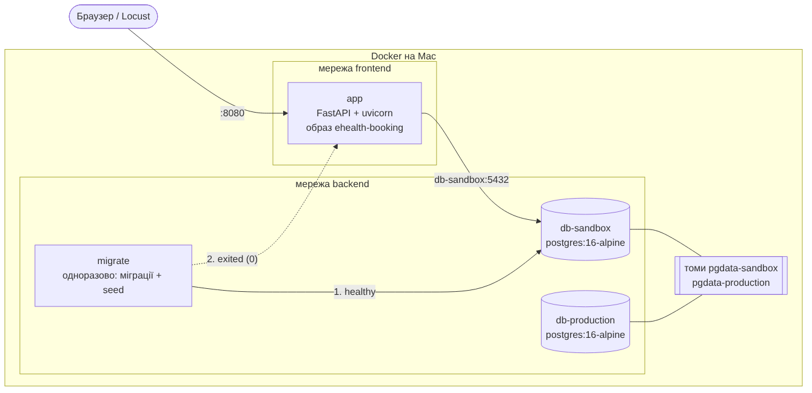

# 7. ЛР5: контейнеризація (Docker, docker compose)

**Мета:** запакувати застосунок і бази даних в ізольовані контейнери та
піднімати всю систему **однією командою**:

```bash
docker compose up --build
```



## Що де зроблено

| Пункт завдання | Де | Коротко |
|---|---|---|
| 1. Dockerfile бекенду | `Dockerfile` | базовий образ `python:3.12-slim`, `WORKDIR /app`, запуск `uvicorn` |
| 1. `.dockerignore` | `.dockerignore` | без `.git`, `__pycache__`, `.venv`, логів і **всіх `.env`** |
| 2. Офіційний образ БД | `docker-compose.yml` | `postgres:16-alpine` |
| 2. Збереження даних | `docker-compose.yml` → `volumes` | томи `pgdata-sandbox`, `pgdata-production` |
| 3. Сервіси в одному файлі | `docker-compose.yml` | `db-sandbox`, `db-production`, `migrate`, `app` |
| 3. Змінні з `.env` | `.env` (паролі БД), `.env.sandbox` (застосунок) | у Git лише шаблони `*.example` |
| 3. Внутрішні мережі | `networks: backend, frontend` | база доступна лише з `backend` |
| 3. Черговість запуску | `depends_on` + `healthcheck` | база healthy → міграції exited (0) → застосунок |
| 4. Перевірка | `scripts/lab5_docker_check.sh`, задача CI «Docker» | API, міграції, дані після перезапуску |
| Дод. 1. Multi-stage | `Dockerfile` (етапи `builder` і `runtime`) | компілятори й кеш pip не потрапляють в образ |
| Дод. 2. Hot reload | `docker-compose.dev.yml` | bind mount `./app` + `uvicorn --reload` |

## 1. Dockerfile

Образ збирається у **два етапи** (multi-stage):

| Етап | Базовий образ | Що відбувається |
|---|---|---|
| `builder` | `python:3.12` (повний, з gcc і заголовками бібліотек) | створюємо `/opt/venv` і встановлюємо `requirements.txt` |
| `runtime` | `python:3.12-slim` (мінімальний Debian) | копіюємо **лише** `/opt/venv` і код (`app/`, `scripts/`) |

Важливі рядки:

```dockerfile
WORKDIR /app                          # робоча директорія
COPY requirements.txt .               # спершу ЛИШЕ залежності → кеш шарів
RUN pip install -r requirements.txt
...
COPY --from=builder /opt/venv /opt/venv   # з першого етапу беремо тільки результат
USER appuser                          # сервер працює НЕ від root
HEALTHCHECK CMD python -c "...urlopen('http://127.0.0.1:8000/health')"
CMD ["uvicorn", "app.main:app", "--host", "0.0.0.0", "--port", "8000", ...]
```

- `requirements.txt` копіюється окремо від коду, тому при зміні коду
  Docker бере шар із залежностями з кешу і не перевстановлює їх.
- `--host 0.0.0.0` — без цього uvicorn слухав би лише сам контейнер, і
  запити ззовні не доходили б.
- `HEALTHCHECK` — Docker сам щоразу перевіряє, чи відповідає застосунок
  (`docker compose ps` показує `healthy`).

## 2. `.dockerignore`

Усе, що вказано в `.dockerignore`, не потрапляє в контекст збирання
й, відповідно, в образ:

- `.git`, `.idea`, `.venv`, `__pycache__`, `*.log` — зайве й важке;
- **`.env`, `.env.*`** — секрети. Образ можна передати будь-кому, і
  паролів у ньому бути не повинно. Змінні передаються в контейнер лише
  під час запуску (`env_file` / `environment` у compose);
- `tests`, `docs`, `loadtest` — серверу для роботи не потрібні.

## 3. База даних і збереження даних

```yaml
db-sandbox:
  image: postgres:16-alpine           # офіційний образ
  volumes:
    - pgdata-sandbox:/var/lib/postgresql/data
  healthcheck:
    test: ["CMD-SHELL", "pg_isready -U ehealth_sandbox -d ehealth_sandbox"]
```

Дані PostgreSQL лежать у **томі Docker** `pgdata-sandbox`, а не всередині
контейнера. Контейнер можна зупинити або видалити
(`docker compose down`), а дані лишаться. Видаляє їх лише явна команда
`docker compose down -v`.

Порти баз відкриті тільки на `127.0.0.1` (лише цей комп'ютер), щоб
локальний `uvicorn` і `pytest` з ЛР2–ЛР3 працювали як раніше, а з мережі
до бази дістатися не можна.

## 4. Оркестрація: `docker-compose.yml`

### Сервіси

| Сервіс | Образ | Роль |
|---|---|---|
| `db-sandbox` | `postgres:16-alpine` | база тестового середовища |
| `db-production` | `postgres:16-alpine` | база робочого середовища (ЛР3) |
| `migrate` | `ehealth-booking` | **одноразово**: створює таблиці й індекси (`scripts/migrate.py`) і початкові дані (`scripts/seed.py`), після чого завершується з кодом 0 |
| `app` | `ehealth-booking` | бекенд FastAPI на http://127.0.0.1:8080 |

**Чому міграції — окремий сервіс.** Раніше таблиці створював кожен
процес застосунку під час старту. Коли копій кілька (ЛР6), вони
стартують одночасно й «б'ються» за створення однієї таблиці. Тепер це
робить один крок `migrate`, а в застосунку `AUTO_MIGRATE=false`.
Скрипт ідемпотентний: можна запускати хоч щоразу, нічого не дублюється
(перевіряють тести `tests/test_docker.py`).

### Змінні оточення

| Файл | Хто читає | Що там |
|---|---|---|
| `.env` | сам docker compose (автоматично) | паролі баз `POSTGRES_PASSWORD_SANDBOX`, `POSTGRES_PASSWORD_PROD` |
| `.env.sandbox` | контейнер застосунку (`env_file`) | `SECRET_KEY`, `ADMIN_*`, налаштування |
| `environment:` у compose | контейнер застосунку | те, що відрізняється в Docker: адреса бази `db-sandbox:5432`, `DEBUG=false` |

У Docker база доступна не за `localhost:5433`, а **за іменем сервісу**
`db-sandbox` і внутрішнім портом 5432. Тому compose перевизначає
`DATABASE_URL` (значення з `environment` важливіше за `env_file`).
Якщо в `.env` немає пароля, compose відмовиться стартувати
(`${POSTGRES_PASSWORD_SANDBOX:?...}`).

### Мережі

- **backend** — бази, `migrate`, `app`;
- **frontend** — `app` (і Nginx у ЛР6).

Сервіси знаходять один одного за іменами (вбудований DNS Docker). База
під'єднана лише до `backend`, тому з `frontend` до неї дістатися неможливо.

### Черговість запуску

```
db-sandbox: starting → healthy (pg_isready)
        ↓  condition: service_healthy
migrate:   міграції + seed → exited (0)
        ↓  condition: service_completed_successfully
app:       starting → healthy (HEALTHCHECK у Dockerfile)
```

Без `healthcheck` `depends_on` чекає лише **старту** контейнера бази, а
PostgreSQL ще кілька секунд після цього не приймає з'єднань, і застосунок
падав би з `connection refused`.

## 5. Перевірка

Однією командою (Docker Desktop має бути запущений):

```bash
bash scripts/lab5_docker_check.sh
```

Скрипт підіймає систему, перевіряє API і базу, перезапускає контейнери
й переконується, що дані збереглися, і порівнює розміри образів.
Повний вивід зберігається в `docs/evidence/lab5-docker-check.txt`.

Те саме вручну:

```bash
docker compose up -d --build
docker compose ps -a            # db-* healthy, migrate exited (0), app healthy
curl http://127.0.0.1:8080/health/db
# {"status":"ok","database":"connected"}
curl http://127.0.0.1:8080/doctors      # лікарі з seed → міграції й seed пройшли
docker compose logs migrate             # «Структура бази актуальна», «Готово!»
```

Також це перевіряє **CI** на кожен Pull Request: задача «Docker» збирає
образ, піднімає всю систему через `docker compose up`, дочікується
`/health/db`, перевіряє лікарів із seed і код завершення `migrate`
(`.github/workflows/ci.yml`).

## 6. Додатково: multi-stage build

Розмір фінального образу порівнюється з етапом `builder` (саме таким був
би образ без multi-stage: повний Python з компіляторами плюс залежності):

```bash
docker build --target builder -t ehealth-booking:builder-stage .
docker image ls | grep ehealth-booking
```

Результат на Mac (з `docs/evidence/lab5-docker-check.txt`):

<!-- LAB5_SIZES -->

## 7. Додатково: режим розробки з hot reload

```bash
docker compose -f docker-compose.yml -f docker-compose.dev.yml up --build
```

`docker-compose.dev.yml` накладається поверх основного файлу:

- `./app` і `./scripts` з Mac **монтуються** в контейнер (bind mount),
  тож контейнер бачить живі файли, а не копію з образу;
- `uvicorn --reload` перезапускає сервер, щойно файл змінено;
- `WATCHFILES_FORCE_POLLING=true` — Docker Desktop на Mac не завжди
  передає в контейнер події «файл змінився», тому зміни перевіряються
  опитуванням.

Перевірка: змінити, наприклад, текст у `app/api/health.py`, зберегти,
і через 1–2 с у `docker compose logs -f app` з'явиться
`WatchFiles detected changes... Reloading`, а
`curl http://127.0.0.1:8080/health` поверне новий текст. Образ при
цьому не перезбирається.

## Корисні команди

| Команда | Що робить |
|---|---|
| `docker compose up -d --build` | зібрати й запустити все у фоні |
| `docker compose up -d db-sandbox db-production` | лише бази (як у ЛР3, для локального uvicorn) |
| `docker compose ps -a` | стан сервісів |
| `docker compose logs -f app` | логи застосунку в реальному часі |
| `docker compose exec db-sandbox psql -U ehealth_sandbox` | консоль бази |
| `docker compose down` | зупинити (дані лишаються) |
| `docker compose down -v` | зупинити й **видалити** дані |
