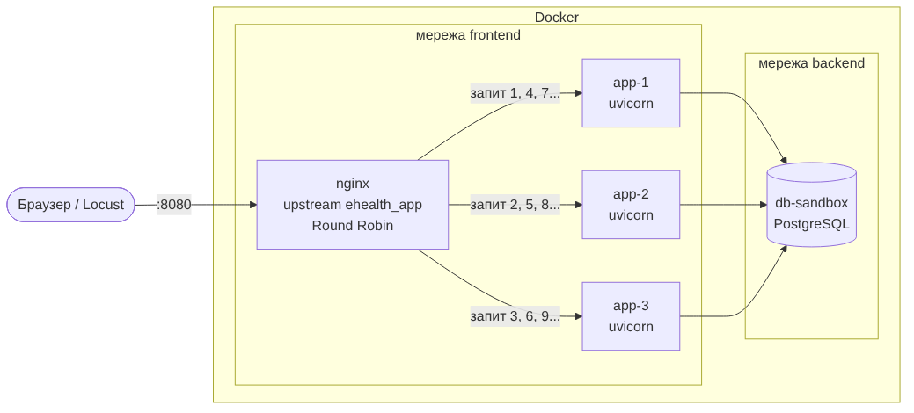
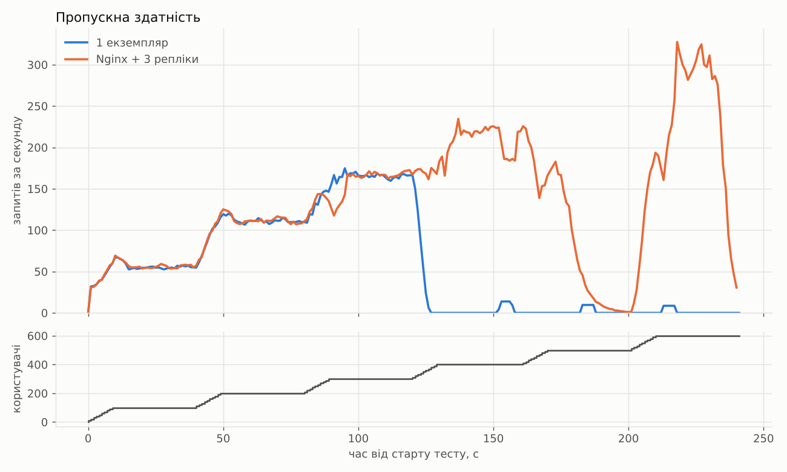
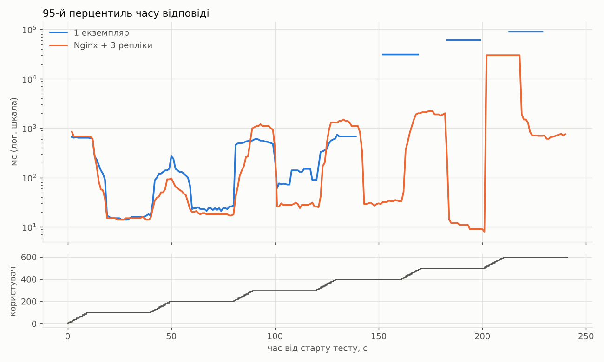

# 8. ЛР6: балансування навантаження (Nginx)

**Мета:** підняти кілька однакових копій (реплік) бекенду, поставити перед
ними Nginx як єдину точку входу і рівномірно розподіляти між ними запити,
щоб збій однієї копії не зупиняв сервіс.



## Що де зроблено

| Пункт завдання | Де | Коротко |
|---|---|---|
| 1. 2–3 репліки | `docker-compose.yml` → `app.deploy.replicas: 3` | кількість змінюється `APP_REPLICAS=N` |
| 1. Ідентифікація сервера | `app/instance.py`, `app/main.py`, `/health` | заголовок `X-Instance` у **кожній** відповіді + поле `instance` у `/health` |
| 2. `upstream` | `config/nginx/templates/default.conf.template` | група `ehealth_app` з усіх реплік сервісу `app` |
| 2. `server` + `proxy_pass` | там само | `listen 80` (на Mac — порт 8080) → `proxy_pass http://ehealth_app` |
| 3. Round Robin | `config/nginx/lb/round_robin.conf` | алгоритм за замовчуванням |
| 3. 10–20 запитів | `scripts/lab6_balancer_check.sh` | 15 запитів, видно чергування реплік |
| 4. Health checks | `max_fails`, `fail_timeout`, `proxy_next_upstream` | збій репліки → трафік лише на здорові |
| Дод. 1. Інші алгоритми | `config/nginx/lb/least_conn.conf`, `ip_hash.conf` | `NGINX_LB=least_conn docker compose up -d` |
| Дод. 2. Порівняльний тест | `loadtest/results/lab6/`, розділ 5 | 1 екземпляр проти Nginx + 3 репліки |

## 1. Репліки застосунку

```yaml
app:
  deploy:
    replicas: ${APP_REPLICAS:-3}
  expose: ["8000"]          # порт НЕ публікується на Mac
  networks: [backend, frontend]
```

Docker запускає 3 однакові контейнери з одного образу. Порт на Mac вони
не публікують: три контейнери не можуть зайняти один порт, і ззовні до
них можна дістатися **лише через Nginx**.

**Яка репліка відповіла?** У Docker hostname контейнера — його короткий
ID (`3f2a9c1b7d4e`), унікальний для кожної репліки. Застосунок додає його:

- у заголовок `X-Instance` **кожної** відповіді (проміжне ПЗ
  `InstanceHeaderMiddleware` в `app/main.py`);
- у тіло `/health`: `{"status":"ok","environment":"sandbox","instance":"3f2a9c1b7d4e"}`.

Nginx, своєю чергою, додає `X-Upstream` — IP і порт репліки, на яку він
переслав запит.

## 2. Nginx як балансувальник

Конфігурація — `config/nginx/templates/default.conf.template`
(головне; повний файл з коментарями — у репозиторії):

```nginx
resolver 127.0.0.11 valid=5s;              # вбудований DNS Docker

upstream ehealth_app {
    zone ehealth_app 64k;
    include /etc/nginx/lb/${NGINX_LB}.conf;     # алгоритм балансування
    server app:8000 resolve max_fails=1 fail_timeout=10s;
    keepalive 32;
}

server {
    listen 80;
    location / {
        proxy_pass http://ehealth_app;
        proxy_next_upstream error timeout http_502 http_503 http_504;
        proxy_connect_timeout 2s;
        add_header X-Upstream $upstream_addr always;
    }
}
```

- **`upstream ehealth_app`** — група серверів. `app` — ім'я сервісу з
  `docker-compose.yml`. DNS Docker повертає на нього IP **усіх трьох**
  реплік, тому в групі три сервери.
- **`resolve`** + `resolver ... valid=5s` — Nginx кожні 5 с перепитує
  DNS, тож нові, зупинені й перезапущені репліки помічає сам, без
  перезапуску.
- **`server { listen 80; proxy_pass ... }`** — вхідний трафік на порт 80
  контейнера (на Mac він опублікований як `8080:80`) пересилається групі.
- Це **шаблон**: офіційний образ Nginx під час старту підставляє змінну
  `NGINX_LB` і кладе готовий файл у `/etc/nginx/conf.d/`.

## 3. Round Robin: 10–20 запитів поспіль

За замовчуванням Nginx використовує Round Robin: кожен наступний запит
іде наступній репліці по колу.

```bash
for i in $(seq 1 15); do
  curl -s -D - -o /dev/null http://127.0.0.1:8080/health | grep -i x-instance
done
```

Результат на тестовому стенді (3 репліки `app1`–`app3` за Nginx,
`loadtest/nginx-bench.conf`):

```
запит  1  HTTP 200  репліка app1  (127.0.0.1:8001)
запит  2  HTTP 200  репліка app3  (127.0.0.1:8003)
запит  3  HTTP 200  репліка app2  (127.0.0.1:8002)
запит  4  HTTP 200  репліка app1  (127.0.0.1:8001)
запит  5  HTTP 200  репліка app3  (127.0.0.1:8003)
запит  6  HTTP 200  репліка app2  (127.0.0.1:8002)
запит  7  HTTP 200  репліка app1  (127.0.0.1:8001)
запит  8  HTTP 200  репліка app3  (127.0.0.1:8003)
запит  9  HTTP 200  репліка app2  (127.0.0.1:8002)
запит 10  HTTP 200  репліка app1  (127.0.0.1:8001)
запит 11  HTTP 200  репліка app3  (127.0.0.1:8003)
запит 12  HTTP 200  репліка app2  (127.0.0.1:8002)
запит 13  HTTP 200  репліка app1  (127.0.0.1:8001)
запит 14  HTTP 200  репліка app3  (127.0.0.1:8003)
запит 15  HTTP 200  репліка app2  (127.0.0.1:8002)
```

Запити йдуть строго по колу: app1 → app3 → app2 → app1 → … (порядок
усередині кола Nginx обирає сам). Кожна репліка отримала рівно по 5
запитів із 15.

Результат у Docker на Mac (`bash scripts/lab6_balancer_check.sh`, повний
вивід у `docs/evidence/lab6-balancer-check.txt`):

<!-- LAB6_RR_DOCKER -->

## 4. Відмовостійкість (health checks)

У безкоштовному Nginx перевірки здоров'я **пасивні**: Nginx оцінює
репліку за реальними запитами.

| Налаштування | Що означає |
|---|---|
| `max_fails=1` | одна невдала спроба (не з'єдналося, тайм-аут) — репліка «хвора» |
| `fail_timeout=10s` | 10 с на «хвору» репліку запити не йдуть, потім Nginx обережно пробує знову |
| `proxy_next_upstream error timeout http_502 http_503 http_504` | невдалий запит **прозоро повторюється** на наступній репліці, клієнт помилки не бачить |
| `proxy_connect_timeout 2s` | недоступна репліка виявляється за 2 с, а не за хвилину |
| `resolve` | зупинений контейнер зникає з DNS Docker, і Nginx за ≤ 5 с прибирає його з групи |

POST-запити (запис до лікаря) Nginx за замовчуванням **не** повторює на
іншій репліці: інакше один клік міг би створити два записи.

**Експеримент:** зупиняємо одну репліку посеред роботи.

```bash
docker stop $(docker compose ps -q app | sed -n 2p)
```

Тестовий стенд (зупинено процес `app2`):

```
запит  1  HTTP 200  репліка app1  (127.0.0.1:8002, 127.0.0.1:8001)
запит  2  HTTP 200  репліка app3  (127.0.0.1:8003)
запит  3  HTTP 200  репліка app1  (127.0.0.1:8001)
запит  4  HTTP 200  репліка app3  (127.0.0.1:8003)
запит  5  HTTP 200  репліка app1  (127.0.0.1:8001)
запит  6  HTTP 200  репліка app3  (127.0.0.1:8003)
запит  7  HTTP 200  репліка app1  (127.0.0.1:8001)
запит  8  HTTP 200  репліка app3  (127.0.0.1:8003)
запит  9  HTTP 200  репліка app1  (127.0.0.1:8001)
запит 10  HTTP 200  репліка app3  (127.0.0.1:8003)
запит 11  HTTP 200  репліка app1  (127.0.0.1:8001)
запит 12  HTTP 200  репліка app3  (127.0.0.1:8003)
```

Лог помилок Nginx у момент збою:

```
[error] connect() failed (111: Connection refused) while connecting to upstream
[warn]  upstream server temporarily disabled while connecting to upstream
```

Що сталося: запит 1 Nginx спершу надіслав на `app2` (8002), отримав
відмову з'єднання, **у межах того самого запиту** переслав його на
`app1` (у заголовку `X-Upstream` видно обидві адреси) і позначив `app2`
як недоступну. Клієнт отримав `200`. Далі всі запити чергуються лише
між двома здоровими репліками, жодної помилки.

У Docker на Mac:

<!-- LAB6_FAIL_DOCKER -->

Після `docker start` репліка через ≤ 10 с (`fail_timeout`) знову
отримує запити.

## 5. Додатково: алгоритми балансування

| Алгоритм | Файл | Як працює | Коли доречний |
|---|---|---|---|
| **Round Robin** (за замовч.) | `lb/round_robin.conf` | по черзі: 1 → 2 → 3 → 1 | репліки однакові, запити схожі за тривалістю |
| **Least Connections** | `lb/least_conn.conf` | новий запит — репліці з найменшою кількістю активних з'єднань | запити дуже різні: вхід (bcrypt, ~350 мс) проти каталогу (~10 мс) |
| **IP Hash** | `lb/ip_hash.conf` | один клієнт (IP) завжди на ту саму репліку | стан у пам'яті репліки («липкі сесії»). У нас стан у БД і JWT, тож не потрібен |

Перемикання без зміни файлів:

```bash
NGINX_LB=least_conn docker compose up -d nginx
NGINX_LB=ip_hash    docker compose up -d nginx
docker compose up -d nginx                       # назад до Round Robin
```

Для нашого навантаження доречний **least_conn**: якщо одна репліка
зайнята кількома повільними входами (bcrypt), нові швидкі запити підуть
на вільніші репліки, а не стануть у чергу за входом лише тому, що «так
випало по колу». З ip_hash під Locust (усі віртуальні користувачі мають
одну IP-адресу) весь трафік пішов би на одну репліку, і балансування
зникло б.

## 6. Додатково: 1 екземпляр проти Nginx + 3 репліки

Той самий сценарій і **стрес-профіль ЛР4** (100 → 600 користувачів,
сходинки по 40 с), та сама машина (2 vCPU, 8 ГБ), на якій Locust працює
поруч із сервером. Різниця лише в розгортанні:

| | 1 екземпляр | Nginx + 3 репліки |
|---|---|---|
| Процеси uvicorn | 1 | 3 (`app1`–`app3`) |
| Пул з'єднань БД | 30 | 3 × 30 = 90 |
| Точка входу | `:8000` напряму | Nginx `:8080` |

**По сходинках** (середнє на плато, без 10 с розгону):

| Користувачів | RPS, 1 екземпляр | p95, мс, 1 екземпляр | RPS, 3 репліки | p95, мс, 3 репліки |
|---:|---:|---:|---:|---:|
| 100 | 55.1 | 16 | 56.0 | 15 |
| 200 | 110.9 | 24 | 111.5 | 18 |
| 300 | 165.2 | 130 | 167.6 | 28 |
| 400 | **3.3** | 31 000 | **212.0** | 32 |
| 500 | 0.0 | 61 000 | 11.3 | — |
| 600 | 0.0 | 90 000 | 230.0 | 710 |

**За весь прогін:**

| | Запитів | Помилки | Медіана, мс | p95, мс | Макс. RPS (5 с) |
|---|---:|---:|---:|---:|---:|
| 1 екземпляр | 13 270 | 115 (0.87 %) | 11 | 380 | 175 |
| Nginx + 3 репліки | **32 241** | 52 (0.16 %) | 15 | 1 200 | **328** |




**Висновки:**

1. **До 200 користувачів різниці немає**: один процес справляється,
   тож упирається все в кількість користувачів, а не в сервер.
   Затримка з репліками навіть трохи нижча (p95 18 проти 24 мс), хоча
   додано ще один мережевий «стрибок» через Nginx: його накладні витрати
   — ~1–2 % CPU.
2. **На 300 користувачах** p95 у одного екземпляра — 130 мс (черга в
   одному процесі), у трьох реплік — 28 мс: навантаження розподілене.
3. **Точка відмови зсунулася з ~350 до ~450–500 користувачів**, а
   максимальна пропускна здатність зросла з ~175 до ~330 RPS (у 1,9 раза).
   Обробили в 2,4 раза більше запитів за той самий час.
4. **Але проблему з ЛР4 це не вирішило, а лише відсунуло.** На ~450–500
   користувачах зависли вже всі три репліки (той самий цикл «потоки ↔
   пул з'єднань», тепер у кожній). Nginx після 30 с очікування повертав
   `504 Gateway Time-out` (32 записи до лікаря), а пацієнти, чий вхід не
   встиг, отримували `401`. Масштабування множить ресурси, але не
   виправляє помилку в коді. Її виправлено в ЛР7.
5. Машина має лише 2 ядра: три процеси Python уже використовують обидва
   (CPU застосунку до 176 %), тож ще більше реплік на цій машині не
   додало б пропускної здатності. У реальній системі репліки
   розносяться на різні сервери.

## Як відтворити

**У Docker (Mac):**

```bash
bash scripts/lab6_balancer_check.sh        # усі демонстрації одразу
docker compose logs nginx                  # куди пішов кожен запит
```

**Тестовий стенд без Docker (Linux), як для навантажувальних тестів:**

```bash
for i in 1 2 3; do
  INSTANCE_NAME=app$i APP_ENV=sandbox DEBUG=false \
    uvicorn app.main:app --port 800$i &
done
nginx -c "$PWD/loadtest/nginx-bench.conf"           # → :8080

LT_STEPS=100,200,300,400,500,600 LT_STEP_SECONDS=40 LT_SPAWN_RATE=10 \
  locust -f loadtest/locustfile.py --host http://127.0.0.1:8080 --headless \
  --csv loadtest/results/lab6/replicas3_stress --csv-full-history

python loadtest/compare.py docs/images/lab6-stress \
  "1 екземпляр=loadtest/results/lab6/single_stress" \
  "Nginx + 3 репліки=loadtest/results/lab6/replicas3_stress"
```
