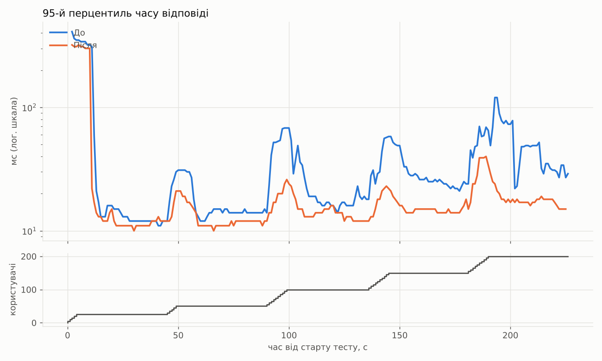
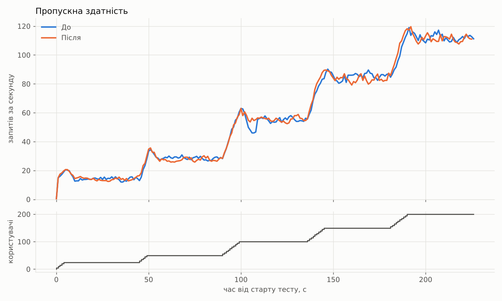
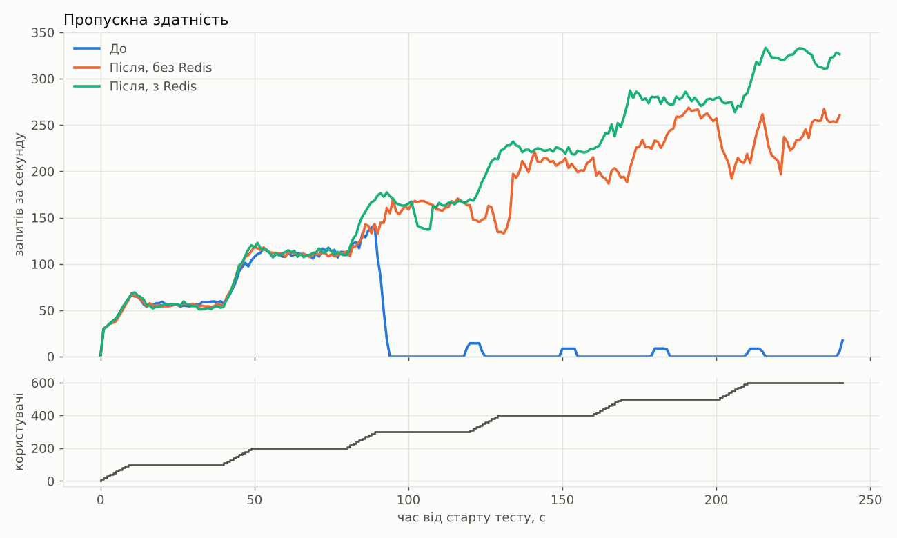
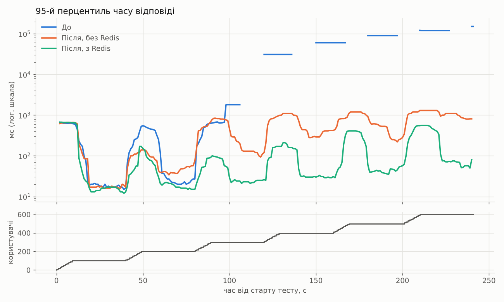

# 9. ЛР7: оптимізація продуктивності

**Мета:** усунути вузькі місця, знайдені в ЛР4, і **виміряти** результат:
той самий інструмент (Locust), той самий сценарій і профілі
навантаження, та сама машина — «ДО» і «ПІСЛЯ».

## Що де зроблено

| Пункт завдання | Де |
|---|---|
| 1. Аналіз вузьких місць, вибір стратегій | розділ 1 |
| 2. Модифікація системи | `app/limiter.py`, `app/config.py`, `app/database.py`, `app/cache.py`, `app/api/catalog.py`, `app/services/booking.py`, `app/models.py`, `app/migrations.py`, `docker-compose.yml` (сервіс `redis`) |
| 2. Бізнес-логіка не порушена | усі 114 старих тестів проходять без змін + 12 нових (`tests/test_performance.py`) |
| 3. Повторне тестування | `loadtest/results/lab7/` (before_* і after_*), розділ 3 |
| 4. Порівняльна таблиця, графіки, висновки | розділи 3–4 |
| Дод. 1. Redis із TTL | `app/cache.py`, розділ 2.2 |
| Дод. 2. EXPLAIN ANALYZE | `scripts/explain_analyze.py`, `docs/evidence/lab7-explain.txt`, розділ 2.3 |

## 1. Аналіз вузьких місць

Перед змінами тест ЛР4 повторено на тій самій машині з тим самим кодом
(`loadtest/results/lab7/before_*`), щоб «ДО» і «ПІСЛЯ» мірялися в
однакових умовах.

| # | Вузьке місце | Докази (ЛР4 + повторний прогін ДО) | Стратегія |
|---|---|---|---|
| 1 | **Взаємне блокування пулу потоків і пулу з'єднань БД.** 40 потоків FastAPI чекають на з'єднання, а 30 з'єднань тримають запити, що чекають на потік | на ~300 користувачах RPS падає з 165 до 0–2, затримки 30/60/90 с, `QueuePool limit ... timeout 30`, CPU падає майже до 0 (сервер не працює, а чекає) | **обмеження одночасних запитів + пул, більший за це обмеження, + короткий тайм-аут** |
| 2 | **Каталог читається в десятки разів частіше, ніж змінюється.** 73 % запитів — спеціальності, лікарі, вільні слоти, однакові для всіх | кожен такий запит: з'єднання з БД → SQL → ORM-об'єкти → валідація pydantic → JSON. CPU застосунку до 110–170 % | **кешування готових JSON-відповідей у Redis із TTL** |
| 3 | **Індекси таблиці `slots` не відповідають головному запиту.** «Вільні слоти лікаря від зараз» фільтрує `is_available`, а жоден індекс його не містить; окремий індекс `doctor_id` дублює `UNIQUE(doctor_id, starts_at)` | `EXPLAIN ANALYZE` на базі розміром з рік роботи (2,5 млн слотів): див. 2.3 | **частковий індекс по вільних слотах, прибрати дубль** |

Чому саме так, а не інакше:

- **№1** не лікується «просто більшим пулом»: кількість запитів, що
  вже тримають з'єднання й чекають на потік, необмежена, тож будь-який
  пул колись закінчиться. Треба обмежити саму кількість запитів у
  роботі. Тоді на кожен із них гарантовано є з'єднання.
- **№2:** база не перевантажена (CPU PostgreSQL ≤ 15 %), основну роботу
  робить Python: ORM і серіалізація. Кеш на рівні **готової відповіді**
  прибирає саме її, а не лише SQL.
- **bcrypt при вході** (вузьке місце №2 з ЛР4) свідомо **не чіпаємо**:
  його повільність — захист паролів. Входів у сценарії мало (вхід один
  раз на сесію), а з репліками (ЛР6) вони розподіляються між процесами.

## 2. Що змінено

### 2.1. Обмеження одночасних запитів і пул з'єднань (стратегія №1)

`app/limiter.py` — «турнікет» на вході (чисте ASGI-проміжне ПЗ):

```python
await asyncio.wait_for(semaphore.acquire(), self.queue_timeout)  # чекаємо в черзі
try:
    await self.app(scope, receive, send)                         # обробляємо
finally:
    semaphore.release()
```

| Налаштування (`app/config.py`) | Було | Стало | Навіщо |
|---|---:|---:|---|
| `MAX_CONCURRENT_REQUESTS` | — | 40 | не більше запитів у роботі, ніж потоків |
| `DB_POOL_SIZE` + `DB_MAX_OVERFLOW` | 10 + 20 = 30 | 20 + 30 = **50** | з'єднань **більше**, ніж запитів у роботі: коло розірвано |
| `DB_POOL_TIMEOUT` | 30 с | **5 с** | навіть якщо щось піде не так — швидка помилка, а не зависання |
| `REQUEST_QUEUE_TIMEOUT` | — | 10 с | хто довше простояв у черзі — одразу `503 Retry-After: 1` |

Черга живе в циклі подій asyncio і нічого не коштує: потік і з'єднання
запит отримує лише тоді, коли проходить «турнікет». `/health` і
`/metrics` турнікет не обмежує, щоб перевірка живучості відповідала
завжди. Оскільки 3 репліки × 50 з'єднань = 150, у `docker-compose.yml`
для PostgreSQL задано `max_connections=200`.

### 2.2. Кеш у Redis (стратегія №2, додаткове завдання 1)

`app/cache.py` + `app/api/catalog.py`:

| Ключ | Що лежить | TTL | Коли скидається одразу |
|---|---|---:|---|
| `catalog:specialties` | JSON списку спеціальностей | 300 с | адмін додав спеціальність |
| `catalog:doctors:<спец.|all>` | JSON списку лікарів | 300 с | адмін додав лікаря |
| `slots:<doctor_id>` | JSON вільних слотів лікаря на 14 днів | **5 с** | запис, скасування, нові слоти цього лікаря |

- У кеші лежить **готова JSON-відповідь** (bytes): на влучанні немає ні
  з'єднання з БД, ні ORM, ні pydantic. Заголовок `X-Cache: HIT/MISS`
  показує, звідки відповідь.
- **Чому слоти не застарівають.** Після кожного запису чи скасування
  ключ лікаря видаляється, тому список змінюється одразу. 5 с TTL
  потрібні лише тому, що слоти «закінчуються» з плином часу. Подвійного
  запису кеш не допускає: сам запис завжди перевіряється в базі з
  `SELECT ... FOR UPDATE` (ЛР2). У найгіршому разі людина побачить
  щойно зайнятий слот і отримає `409`, як і без кешу.
- **Кеш необов'язковий.** Без `REDIS_URL` або коли Redis недоступний,
  застосунок читає з бази (тест `test_broken_redis_falls_back_to_database`).
  Після помилки Redis 5 с не опитується, щоб кожен запит не чекав
  тайм-ауту.
- У Docker — сервіс `redis` (`redis:7-alpine`, без запису на диск,
  максимум 64 МБ, витіснення LRU).

### 2.3. Індекси й EXPLAIN ANALYZE (стратегія №3, додаткове завдання 2)

Демо-база дуже маленька (2 560 слотів), і на ній будь-який план
виконується за частки мілісекунди. Тому `scripts/explain_analyze.py`
створює окрему тимчасову базу з обсягом, як у поліклініки за рік:
200 лікарів × 395 днів × 32 слоти ≈ **2,5 млн слотів** (85 % минулих і
30 % майбутніх зайняті). Повний вивід —
`docs/evidence/lab7-explain.txt`.

**Головний запит — вільні слоти лікаря на 14 днів** (`GET /doctors/{id}/slots`):

| | ДО (індекси ЛР2–ЛР6) | ПІСЛЯ (частковий індекс) |
|---|---|---|
| Індекс у плані | `slots_doctor_id_starts_at_key` (усі слоти) | `ix_slots_free_by_doctor` (лише вільні) |
| Рядків з індексу | 448 | 296 |
| `Rows Removed by Filter` (зайняті, відкинуті даремно) | **152** | **0** |
| Прочитано сторінок (Buffers: shared hit) | 454 | 300 (**−34 %**) |
| Оцінка вартості (cost) | 1 550 | 336 (**−78 %**) |
| Execution Time | 0.50 мс | 0.32 мс (**−37 %**) |

План ДО (скорочено):

```
Bitmap Heap Scan on slots  (actual rows=296)
  Recheck Cond: (doctor_id = 42) AND (starts_at > now()) AND (starts_at < now() + 14 days)
  Filter: is_available
  Rows Removed by Filter: 152          ← зайняті слоти прочитано й викинуто
  Buffers: shared hit=454
  -> Bitmap Index Scan on slots_doctor_id_starts_at_key  (rows=448)
Execution Time: 0.502 ms
```

План ПІСЛЯ:

```
Bitmap Heap Scan on slots  (actual rows=296)
  Recheck Cond: ... AND is_available
  Buffers: shared hit=300
  -> Bitmap Index Scan on ix_slots_free_by_doctor  (rows=296)   ← лише вільні
Execution Time: 0.315 ms
```

**Розміри індексів:** прибраний `ix_slots_doctor_id` займав 17 МБ і
дублював перший стовпець `UNIQUE(doctor_id, starts_at)` (108 МБ); новий
частковий `ix_slots_free_by_doctor` — 15 МБ, бо містить лише ~19 %
рядків (вільні слоти). Тобто швидший запит отримано **без збільшення**
загального розміру індексів, а вставка слотів оновлює на один повний
індекс менше.

**Чесний висновок щодо індексів.** Навіть на 2,5 млн рядків запит
триває частки мілісекунди і до, і після: схема з ЛР1 вже мала складений
індекс. Тому на загальний RPS індекс впливає мало. Він важливий на
перспективу: що більше накопичується зайнятих слотів за роки, то більше
рядків старий план читав би даремно, а новий — ні. Запит статистики
адміністратора (`count(*)` вільних майбутніх слотів, 24 мс) використовує
`ix_slots_starts_at` в обох випадках і не змінився. Він рідкісний, тому
окремого індексу для нього не додавали.

## 3. Повторне навантажувальне тестування

Умови ті самі, що в ЛР4: `loadtest/locustfile.py` без змін, той самий
профіль, **1 процес uvicorn** (щоб порівнювати саме код, а не кількість
реплік), машина 2 vCPU / 8 ГБ, Locust на тій самій машині. Перед кожним
прогоном записи очищаються, а кеш Redis — порожній.

### 3.1. Основний прогін (25 → 200 користувачів)

| Користувачів | RPS ДО | RPS ПІСЛЯ | p95 ДО, мс | p95 ПІСЛЯ, мс |
|---:|---:|---:|---:|---:|
| 25 | 14.1 | 14.0 | 12 | 11 |
| 50 | 28.6 | 27.5 | 14 | 11 |
| 100 | 55.2 | 55.4 | 17 | 14 |
| 150 | 85.8 | 83.2 | 25 | 15 |
| 200 | 112.1 | 111.3 | 34 | **17** |

| За весь прогін | ДО | ПІСЛЯ | Зміна |
|---|---:|---:|---:|
| Запитів | 13 251 | 13 164 | — |
| Error Rate | 0 % | 0 % | — |
| Latency, середня | 14.1 мс | 8.5 мс | **−40 %** |
| Latency, медіана | 8 мс | 4 мс | **−50 %** |
| Latency, p95 | 33 мс | 17 мс | **−48 %** |
| Latency, p99 | 140 мс | 66 мс | **−53 %** |
| CPU застосунку, середнє (100 % = 1 ядро) | 34.2 % | 24.3 % | **−29 %** |
| CPU PostgreSQL, середнє | 4.9 % | 3.8 % | −22 % |
| RAM застосунку, середнє | 107 МБ | 111 МБ | +4 МБ (Redis-клієнт) |

RPS у цьому профілі не змінився, і так і має бути: при 200 користувачах
кількість запитів задають самі користувачі (пауза 1–3 с між діями), а не
сервер. Сервер просто обробляє той самий потік **удвічі швидше і з
меншим CPU**.

По ендпоінтах (середній час, мс):

| Ендпоінт | ДО | ПІСЛЯ | Чому |
|---|---:|---:|---|
| `GET /doctors/[id]/slots` | 12.7 | **5.2** | кеш Redis |
| `GET /doctors` | 9.4 | **4.3** | кеш Redis |
| `GET /specialties` | 8.4 | **3.7** | кеш Redis |
| `GET /appointments/me` | 12.6 | 9.4 | менше конкуренції за CPU і БД |
| `POST /appointments` | 19.3 | 16.2 | частковий індекс + менше конкуренції |
| `POST /auth/token` | 393 | 374 | bcrypt — свідомо без змін |




### 3.2. Стрес-прогін (100 → 600 користувачів)

Щоб зрозуміти, **який захід що дав**, «ПІСЛЯ» проміряно двічі: з усіма
змінами і без Redis (лише обмежувач запитів + пул + індекс).

| Користувачів | RPS ДО | RPS ПІСЛЯ без Redis | RPS ПІСЛЯ з Redis | p95 ДО, мс | p95 без Redis, мс | p95 з Redis, мс |
|---:|---:|---:|---:|---:|---:|---:|
| 100 | 57.1 | 55.3 | 54.5 | 18 | 17 | 15 |
| 200 | 111.3 | 110.5 | 111.9 | 23 | 41 | 17 |
| 300 | **1.1** | 164.3 | 159.3 | 1 800 | 130 | 24 |
| 400 | **2.0** | 209.1 | 222.7 | 60 000 | 410 | 30 |
| 500 | **2.0** | 252.8 | 277.3 | 90 000 | 530 | 42 |
| 600 | **1.1** | 243.0 | **323.0** | 120 000 | 1 000 | **71** |

| За весь прогін | ДО | ПІСЛЯ без Redis | ПІСЛЯ з Redis |
|---|---:|---:|---:|
| Запитів оброблено | 8 048 | 39 049 | **45 209** (×5.6) |
| Error Rate | 2.37 % | 0.01 % | **0.00 %** |
| Latency, середня | 3 386 мс | 340 мс | **48 мс** |
| Latency, медіана | 12 мс | 190 мс | 10 мс |
| Latency, p95 | 640 мс* | 1 000 мс | **300 мс** |
| Latency, p99 | 121 000 мс | 1 300 мс | **520 мс** |
| Latency, максимум | 151 с | 2.5 с | **1.6 с** |
| Макс. RPS (вікно 5 с) | 175 | 269 | **333** |
| Точка відмови | **~300 користувачів** | не досягнуто | не досягнуто |
| CPU застосунку, сер. / макс. | 28 % / 171 % | 89 % / 174 % | 69 % / 167 % |
| CPU PostgreSQL, сер. / макс. | 3.5 % / 40 % | 12.4 % / 28 % | 7.8 % / 19 % |
| RAM застосунку, сер. | 128 МБ | 124 МБ | 119 МБ |

\* p95 «ДО» занижений: більшість запитів після зависання так і не
отримали відповіді до кінця тесту. Середній CPU «ДО» низький не тому,
що сервер працює ефективно, а тому, що він більшу частину тесту стояв.

Помилки «ПІСЛЯ» (2 і 5 шт.) — це `404` на `DELETE /appointments/[id]`:
віртуальний пацієнт двічі поспіль скасовує той самий запис. Це
нормальна відповідь API, а не збій сервера.




### 3.3. Для порівняння: усі оптимізації + 3 репліки за Nginx (ЛР6)

| Користувачів | RPS, 1 процес | p95, 1 процес | RPS, 3 репліки | p95, 3 репліки |
|---:|---:|---:|---:|---:|
| 400 | 222.7 | 30 мс | 223.6 | 17 мс |
| 600 | 323.0 | 71 мс | 315.7 | **16 мс** |

До оптимізацій навіть 3 репліки зависали на ~450–500 користувачах
(ЛР6). Після оптимізацій один процес уже не падає, а 3 репліки ще й
тримають p95 на рівні 16 мс навіть на 600 користувачах. Повна система
(Nginx + 3 репліки + Redis) — це конфігурація для ЛР8.

## 4. Висновки

| Захід | Що дав | Ефект |
|---|---|---|
| **1. Обмежувач запитів + пул 50 + тайм-аут 5 с** | система **більше не зависає**: на 300–600 користувачах 164–253 RPS замість 1–2, помилок 2.37 % → 0.01 % | **найбільший**: перетворює відмову системи на роботу |
| **2. Кеш Redis** | на 600 користувачах +33 % RPS (243 → 323), p95 у 14 разів нижчий (1 000 → 71 мс); на основному профілі p95 −48 %, CPU застосунку −29 % | найбільший приріст **швидкодії** |
| **3. Частковий індекс** | головний запит −37 % часу і −34 % прочитаних сторінок у БД, без збільшення розміру індексів | малий зараз (запит і так < 1 мс), важливий з ростом даних |

1. **Найбільший приріст дав захід №1**: він прибрав не «повільність», а
   **відмову**. Без нього жодна інша оптимізація не мала б сенсу: кеш
   не допоміг би серверу, що стоїть.
2. **Найбільший приріст швидкодії дав кеш**: 73 % запитів більше не
   йдуть ні в базу, ні в ORM, ні в pydantic. Без Redis сервер на 600
   користувачах упирається в CPU (застосунок 174 %), а з Redis на ту
   саму роботу йде менше CPU, і p95 лишається двоцифровим.
3. Бізнес-логіка не порушена: усі старі тести проходять, подвійних
   записів під навантаженням немає (409 замість другого запису), а
   скинутий після запису кеш показує актуальні слоти.
4. **Наступне вузьке місце** — CPU самого застосунку (Python) і вхід з
   bcrypt. Їх вирішують горизонтальним масштабуванням (ЛР6) на окремі
   машини, а не оптимізацією коду.

## Як відтворити

```bash
APP_ENV=sandbox python -m scripts.migrate          # частковий індекс, без дубля
APP_ENV=sandbox python -m scripts.explain_analyze > docs/evidence/lab7-explain.txt

# Сервер ПІСЛЯ: з кешем (Redis має працювати на 6379)
REDIS_URL=redis://localhost:6379/0 APP_ENV=sandbox DEBUG=false \
    uvicorn app.main:app --port 8000

python loadtest/monitor.py loadtest/results/lab7/after_stress_resources.csv &
LT_STEPS=100,200,300,400,500,600 LT_STEP_SECONDS=40 LT_SPAWN_RATE=10 \
    locust -f loadtest/locustfile.py --host http://127.0.0.1:8000 --headless \
    --csv loadtest/results/lab7/after_stress --csv-full-history

python loadtest/compare.py docs/images/lab7-stress \
    "До=loadtest/results/lab7/before_stress" \
    "Після=loadtest/results/lab7/after_stress"
```
