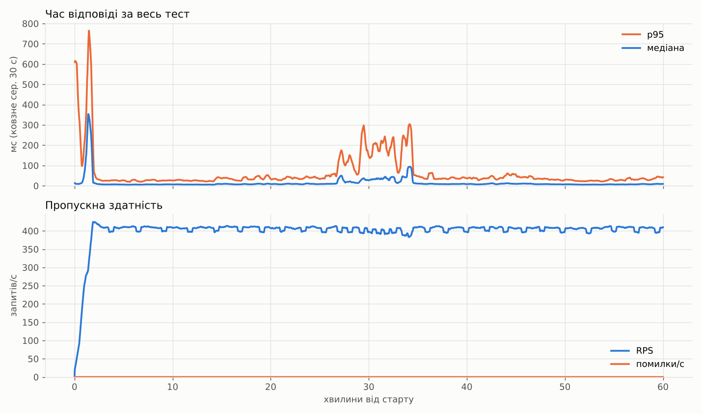
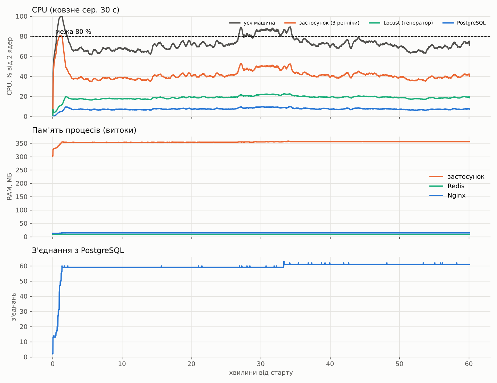
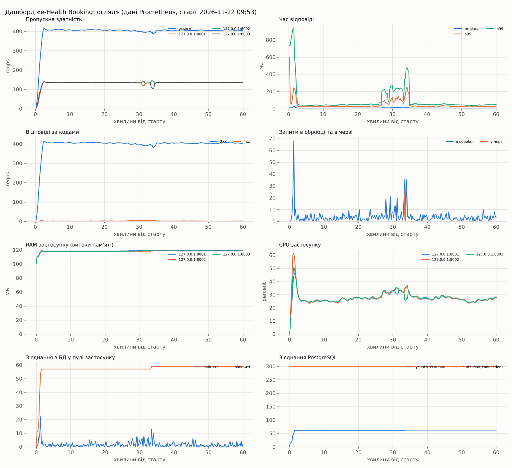
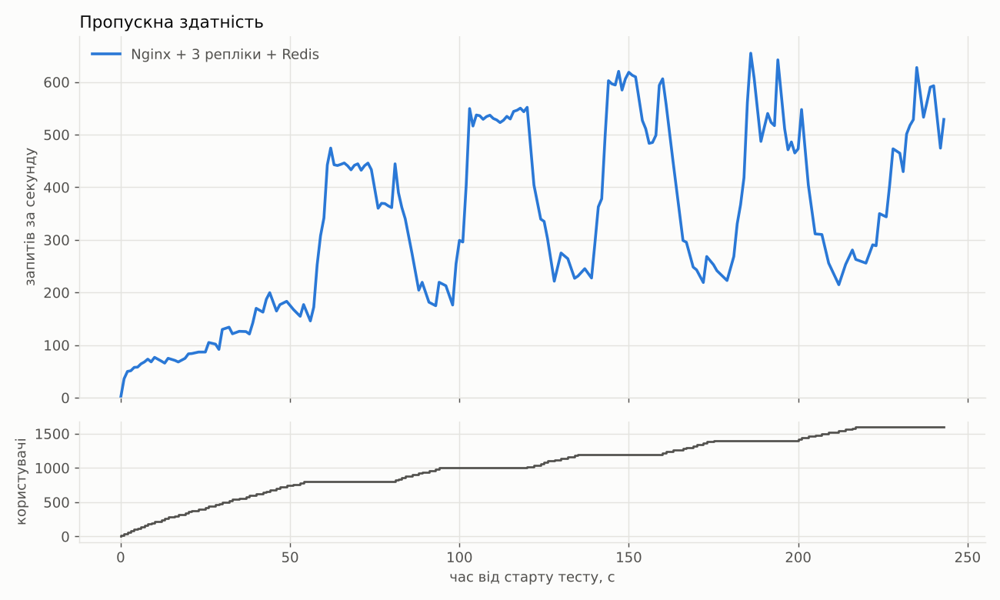
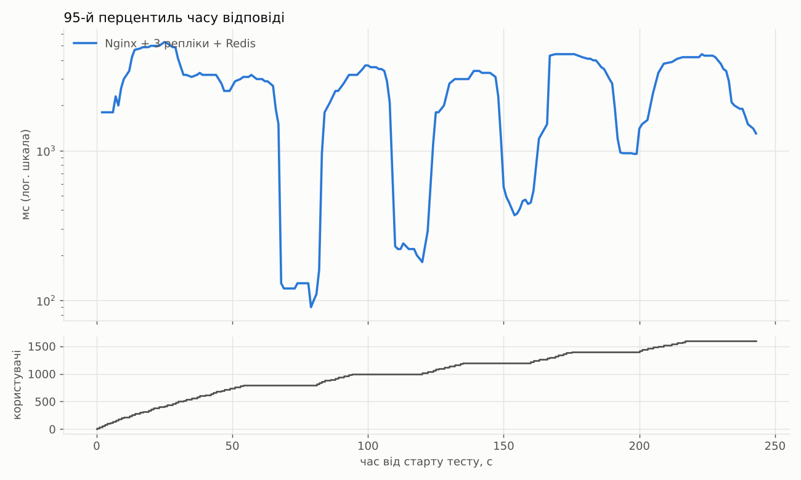
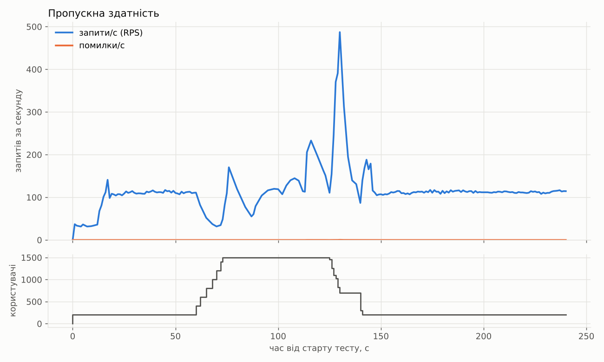
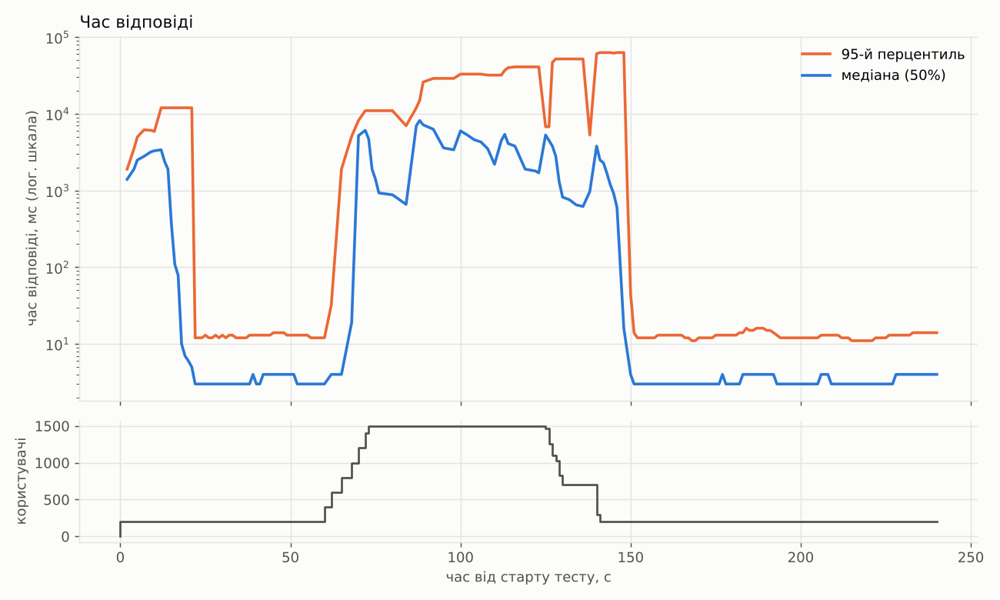

# 10. ЛР8: фінальне тестування стабільності

**Мета:** довести, що система витримує стабільне робоче навантаження
**тривалий час** без відмов, деградації швидкодії та витоку ресурсів, і
оформити підсумковий звіт.

## Що де зроблено

| Пункт завдання | Де |
|---|---|
| 1. Профіль стабільності, критерії успіху | розділ 1 |
| 2. Тривалий тест (Soak) + постійний збір метрик | розділ 2; `loadtest/results/lab8/soak_*` |
| 3. Аналіз витоків пам'яті й деградації затримки | розділ 3 |
| 4. Підсумковий протокол, графіки, висновок | розділи 4–5 |
| Дод. 1. Пошук точки зламу й spike-тест | розділ 6; `loadtest/results/lab8/breakpoint_*`, `spike_*` |
| Дод. 2. Prometheus + Grafana | розділ 7; `config/prometheus/`, `config/grafana/`, `app/metrics.py` |

## Система, що тестується

Фінальна конфігурація після ЛР5–ЛР7, як у `docker-compose.yml`:

| Компонент | Конфігурація |
|---|---|
| Балансувальник | Nginx, Round Robin, пасивні health checks |
| Застосунок | **3 репліки** uvicorn, у кожній обмежувач 40 запитів і пул БД 20 + 30 |
| Кеш | Redis (каталог 300 с, слоти 5 с + інвалідація) |
| База | PostgreSQL 16, частковий індекс вільних слотів |
| Моніторинг | Prometheus (кожні 5 с) + postgres-exporter; `loadtest/monitor.py` (CPU/RAM процесів і з'єднання з БД щосекунди) |
| Машина | 2 vCPU, 8 ГБ RAM, Linux. **Locust працює на тій самій машині** і забирає частину CPU |

Тестовий стенд — ті самі процеси без Docker (`loadtest/nginx-bench.conf`,
`loadtest/prometheus-bench.yml`): у хмарній VM Docker Hub недоступний.
Конфігурація Nginx, застосунку, Redis і PostgreSQL та сама; у Docker на
Mac усе це піднімає одна команда (розділ 7).

## 1. Профіль стабільності і критерії успіху

**Максимальна пропускна здатність** визначена тестом до відмови
(розділ 6): система виходить на «стелю» **≈ 550 RPS** при ~1 000
користувачів, далі RPS не росте, а лише збільшується затримка.

| Параметр | Значення |
|---|---|
| Цільове навантаження | **75 % від максимуму ≈ 410 RPS** |
| Віртуальних користувачів | 760 (сценарій ЛР4: 60 % відвідувачі, 40 % пацієнти, пауза 1–3 с) |
| Розгін | 10 користувачів/с (≈ 76 с) |
| Тривалість | **60 хв** на сталому рівні |
| Збір метрик | Locust — щосекунди (RPS, перцентилі, помилки); `monitor.py` — щосекунди (CPU/RAM кожної групи процесів, з'єднання з БД); Prometheus — кожні 5 с |

| Критерій успіху | Межа |
|---|---|
| CPU | ≤ 80 % |
| RAM | ≤ 80 % |
| Error Rate | ≤ 0.1 % |
| Деградація | немає стійкого росту p95 і RAM упродовж тесту |

**Як рахується CPU.** Locust генерує навантаження на **тій самій**
машині й сам забирає 15–25 % її CPU. Тому окремо наведено CPU усієї
машини і CPU **системи, що тестується** (застосунок + Nginx + PostgreSQL
+ Redis): саме її стосується критерій ≤ 80 %.

## 2. Тривалий тест (Soak, 60 хв)

```bash
LT_STEPS=760 LT_STEP_SECONDS=3600 LT_SPAWN_RATE=10 \
  locust -f loadtest/locustfile.py --host http://127.0.0.1:8080 --headless \
  --csv loadtest/results/lab8/soak --csv-full-history
MONITOR_DSN=postgresql://... python loadtest/monitor.py loadtest/results/lab8/soak_resources.csv
```

Сирі дані: `loadtest/results/lab8/soak_stats.csv` (підсумок по
ендпоінтах), `soak_stats_history.csv` (щосекунди, 3 600 рядків),
`soak_resources.csv` (щосекунди: CPU/RAM застосунку, БД, Nginx, Redis,
Locust, з'єднання з БД). Звіт будує `loadtest/soak_report.py`.

## 3. Аналіз довгострокової поведінки

### Стабільність по 10-хвилинних відрізках

| Відрізок, хв | RPS | Медіана, мс | p95, мс | Помилки/с | CPU машини, % | RAM застосунку, МБ | З'єднань з БД |
|---|---:|---:|---:|---:|---:|---:|---:|
| 0–10 (з розгоном) | 381.0 | 7 | 27 | 0.005 | 70.5 | 351 | 55 |
| 10–20 | 407.4 | 7 | 28 | 0.002 | 68.7 | 354 | 59 |
| 20–30 | 404.8 | 10 | 43 | 0.005 | 75.9 | 354 | 59 |
| 30–40 | 402.1 | 11 | 48 | 0.013 | 78.7 | 356 | 60 |
| 40–50 | 406.0 | 8 | 35 | 0.008 | 72.7 | 356 | 61 |
| 50–60 | 406.3 | 7 | 27 | 0.007 | 68.6 | 356 | 61 |

### Тренди (лінійна регресія по всьому тесту, без перших 2 хв)

| Показник | Нахил | Висновок |
|---|---:|---|
| RAM застосунку (3 репліки) | +4 МБ/год | **витоку немає**: 351 → 356 МБ за першу половину тесту (прогрів кешів Python), далі рівна лінія |
| p95 затримки | +6 мс/год | **деградації немає**: p95 на 50–60 хв (27 мс) такий самий, як на 10–20 хв (28 мс) |
| RPS | −2.4 RPS/год | стабільно: 402–407 RPS на кожному відрізку |
| З'єднання з БД | +3 з'єднання/год | **витоку з'єднань немає**: пул відкрив 59 з'єднань під час розгону і 61 на 33-й хв, далі не росте. Зайнятих одночасно — 0–13 (дашборд, розділ 5) |
| RAM PostgreSQL | +147 МБ/год | не витік: це сума RSS процесів PostgreSQL, і кожне з 61 з'єднань поступово «торкається» спільного буфера (`shared_buffers`), який рахується в RSS кожного процесу. Загальна RAM машини за годину: 16.1 % → 16.6 % |




**Епізод на 27–35 хв.** p95 короткочасно зріс до 90–130 мс (p99 — до
~480 мс), CPU машини — до 80–88 %. RPS при цьому не впав, помилок не
додалося, у черзі обмежувача на кілька секунд з'явилося до ~25 запитів,
а з'єднань з БД відкрилося на 2 більше (59 → 61). Після 35-ї хвилини все
повернулося до початкового рівня **без перезапуску** і більше не
повторювалося. Ріст охопив усі процеси одночасно: застосунок, Locust і
PostgreSQL. Найімовірніше, це конкуренція за CPU на спільній хмарній VM,
де сервер і генератор навантаження працюють разом. Тренду це не
утворило: остання третина тесту найшвидша.

## 4. Підсумковий протокол

| Метрика | Значення | Критерій | |
|---|---:|---|:-:|
| Тривалість на сталому навантаженні | **60 хв** | 1–4 год | ✅ |
| Запитів усього | 1 443 498 | | |
| **RPS** (середній на плато) | **405.7** | 70–80 % від ~550 | ✅ 74 % |
| Latency Avg | 20.0 мс | | |
| Latency Min | 1.1 мс | | |
| Latency Max | 2 822 мс | | |
| Latency p50 | 9 мс | | |
| **Latency p95** | **61 мс** | | |
| **Latency p99** | **230 мс** | | |
| **Error Rate** | **0.002 %** (24 з 1 443 498) | ≤ 0.1 % | ✅ |
| CPU системи (застосунок + Nginx + БД + Redis), сер. / макс. | **51.1 % / 79.8 %** | ≤ 80 % | ✅ |
| CPU усієї машини разом із Locust, сер. / макс. | 72.0 % / 99.6 % | — | ⚠️ див. нижче |
| RAM машини, сер. / макс. | **16.1 % / 16.6 %** | ≤ 80 % | ✅ |
| RAM застосунку (3 репліки), початок → кінець | 354 → 356 МБ | без росту | ✅ |
| З'єднання з БД, початок → кінець | 59 → 61 (з 300 можливих) | без росту | ✅ |

- **Помилки** — це 24 відповіді `404` на `DELETE /appointments/[id]`:
  віртуальний пацієнт двічі скасовує той самий запис. Це коректна
  відповідь API; помилок сервера (5xx) і тайм-аутів — **нуль**.
- **Max 2,8 с** — поодинокі входи (bcrypt) під час розгону, коли
  760 користувачів стартують за 76 с.
- **CPU машини з Locust** перевищував 80 % під час розгону (вхід
  304 пацієнтів за хвилину) і в епізоді на 27–35 хв. Сама система
  (без генератора) не перевищила 79.8 %.

## 5. Висновок щодо готовності до експлуатації

**Система відповідає вимогам стабільності** для цільового навантаження
~400 RPS (≈ 760 одночасних користувачів у сценарії «запис о 8:00»):

1. **Годину без відмов:** 1,44 млн запитів, жодної помилки сервера, p95
   61 мс, p99 230 мс.
2. **Витоків немає:** RAM застосунку і кількість з'єднань з БД
   вийшли на плато за перші хвилини й далі не росли; черга обмежувача
   порожня.
3. **Деградації немає:** p95 наприкінці тесту такий самий, як на
   початку; разовий епізод на 27–35 хв минув сам.
4. **Запас міцності:** стеля ~550 RPS (розділ 6), і навіть за нею
   система не падає, а сповільнюється. Після стрибка до 1 500
   користувачів відновлюється за ~10 с.

**Що врахувати перед production:**

- **Окремі машини.** На тестовій VM генератор і сервер ділили 2 ядра.
  Для реальної експлуатації — окремі сервери для реплік, бази й
  балансувальника; цільовий запас CPU ≤ 60–70 % на піку.
- **Масовий вхід** — найслабше місце (розділ 6.2): rate limit на
  `/auth/token` у Nginx і довше життя токена.
- **Моніторинг з алертами:** дашборд Grafana вже є (розділ 7). Варто
  додати сповіщення на p95 > 200 мс, помилки 5xx > 0.1 % і живих реплік
  < 3.

Дашборд за час Soak-тесту (ті самі запити, що в Grafana, дані з
Prometheus тестового стенду, `loadtest/prom_snapshot.py`):



Що видно на дашборді: три репліки отримують рівно по ~135 RPS
(балансування рівномірне); RAM кожної репліки — рівна лінія ~118 МБ;
CPU кожної репліки 25–35 % ядра; з'єднань у пулі відкрито 57–59, а
зайнято одночасно 0–13; з'єднань PostgreSQL ~60 при ліміті 300.

## 6. Додатково: точка зламу і spike-тест

### 6.1. Покрокове навантаження до відмови

Профіль: 600 → 800 → 1 000 → 1 200 → 1 400 → 1 600 користувачів по
40 с, розгін 20 користувачів/с.

| Користувачів | RPS | p95, мс | Помилки/с | CPU машини, % | CPU застосунку (3 репліки), % ядра | CPU Locust, % ядра |
|---:|---:|---:|---:|---:|---:|---:|
| 800 | 415 | 120 | 0.03 | 86 | 106 | 39 |
| 1 000 | **537** | 220 | 0.00 | 96 | 119 | 42 |
| 1 200 | 562 | 460 | 0.02 | 97 | 115 | 46 |
| 1 400 | 515 | 970 | 0.17 | 97 | 117 | 46 |
| 1 600 | 551 | 1 900 | 0.48 | 96 | 118 | 45 |




- **Точка зламу (Break Point) ≈ 1 000–1 200 користувачів, ≈ 550 RPS.**
  Після неї RPS більше не росте (540–560), а p95 подвоюється на кожній
  сходинці: 220 → 460 → 970 → 1 900 мс. Причина — **CPU машини 96–97 %**
  (база при цьому лише ~20 % ядра).
- **Відмови як у ЛР4 немає.** Сервер не зависає й не падає: помилок за
  весь тест 0.04 % (і це `404` на повторне скасування того самого
  запису), з'єднань з БД стабільно ~62 (≤ 150 можливих). Система
  деградує «м'яко»: стає повільнішою, але відповідає всім.
- «Пилка» на графіку — розгони: кожні нові 200 пацієнтів одночасно
  входять (bcrypt), і на 10–20 с RPS просідає до ~220.
- Частину CPU (до 46 % ядра) забирав сам Locust. На окремій машині для
  генератора стеля сервера була б вищою.

### 6.2. Spike: раптовий стрибок 200 → 1 500 → 200 користувачів

Профіль: 60 с по 200 користувачів, потім **+1 300 користувачів за
6,5 с** (200 користувачів/с), 60 с по 1 500, різке повернення до 200 і
ще 2 хв спостереження.

| Фаза | RPS | Медіана | p95 | Помилки |
|---|---:|---:|---:|---:|
| 200 користувачів (до стрибка) | ~112 | 3–4 мс | 12–13 мс | 0 |
| Стрибок до 1 500 | 80–170 | 1,8–7 с | 11–41 с | 0.1/с |
| Повернення до 200 | ~110 | **3 мс через ~10 с** | 12 мс | 0 |




- **Система пережила стрибок без падіння.** За весь тест 0.02 %
  помилок (5 повторних скасувань), жодного `500`, жодного зависання.
- **Час відновлення ≈ 10 с.** Після зменшення навантаження медіана
  повернулася з секунд до 3 мс, а RPS — до ~110 за ~10 с. У ЛР4 сервер
  після перевантаження не відповідав кілька хвилин.
- **Слабке місце під час стрибка — вхід.** 520 нових пацієнтів
  одночасно входять, кожен вхід — ~0,3 с CPU на bcrypt, тож черга
  входів розтягується до хвилини (p95 входу 62 с). Через це просідають
  й інші запити. Рекомендації для production: обмежити частоту входів
  (rate limit у Nginx `limit_req` на `/auth/token`), винести вхід в
  окремі воркери або окремий сервіс автентифікації, довше життя токена,
  щоб люди не входили повторно.

## 7. Додатково: моніторинг Prometheus + Grafana

### Що збирається

`app/metrics.py` (бібліотека `prometheus-fastapi-instrumentator`): кожна
репліка віддає на `/metrics`:

| Метрика | Що показує |
|---|---|
| `http_requests_total{handler, method, status}` | лічильник запитів → RPS і частка помилок 5xx |
| `http_request_duration_highr_seconds_bucket` | гістограма часу відповіді → p50 / p95 / p99 |
| `process_resident_memory_bytes` | RAM процесу → **витоки пам'яті** |
| `process_cpu_seconds_total` | CPU процесу |
| `ehealth_db_pool_checked_out`, `ehealth_db_pool_open` | зайняті й відкриті з'єднання пулу → **витоки з'єднань** |
| `ehealth_requests_in_flight`, `ehealth_requests_queued` | стан обмежувача запитів з ЛР7 |

Плюс `postgres-exporter`: `pg_stat_database_numbackends` (з'єднання з
базою), `pg_settings_max_connections`. Prometheus знаходить усі репліки
через DNS Docker (`dns_sd_configs: names: [app]`). Ззовні, через
Nginx, `/metrics` недоступний (`location = /metrics { return 404; }`).

### Запуск (Docker, Mac)

```bash
docker compose --profile monitoring up -d
```

| Сервіс | Адреса |
|---|---|
| Grafana | http://127.0.0.1:3000 — дашборд «e-Health Booking: огляд» відкривається одразу, без входу |
| Prometheus | http://127.0.0.1:9090 (Status → Targets: 3 репліки `ehealth-app` і `postgres` у стані UP) |

Профіль `monitoring` не запускається звичайним `docker compose up`:
моніторинг вмикається, коли потрібен. Джерело даних і дашборд
підключаються автоматично (provisioning): `config/grafana/provisioning/`,
`config/grafana/dashboards/ehealth.json`.

### Дашборд «e-Health Booking: огляд»

| Ряд | Панелі |
|---|---|
| Головне зараз | RPS · p95 · % помилок 5xx (червоний > 0.1 %) · кількість живих реплік |
| Навантаження | RPS усього і по кожній репліці (рівномірність балансування) · медіана / p95 / p99 |
| Помилки й черга | відповіді за кодами 2xx/4xx/5xx · запити в обробці та в черзі обмежувача |
| Витоки | RAM кожної репліки · CPU кожної репліки |
| База даних | з'єднання пулу застосунку · усі з'єднання PostgreSQL проти `max_connections` |

Знімки справжньої Grafana з Mac (`docker compose --profile monitoring up -d`,
навантаження Locust на http://127.0.0.1:8080): `docs/evidence/grafana-*.png`.

<!-- LAB8_GRAFANA_SCREENSHOTS -->

## Як відтворити

```bash
# Тестовий стенд (Linux, без Docker): 3 репліки + Nginx + Redis + Prometheus
for i in 1 2 3; do
  INSTANCE_NAME=app$i REDIS_URL=redis://localhost:6379/0 APP_ENV=sandbox \
    DEBUG=false AUTO_MIGRATE=false uvicorn app.main:app --port 800$i &
done
nginx -c "$PWD/loadtest/nginx-bench.conf"
prometheus --config.file=loadtest/prometheus-bench.yml --storage.tsdb.path=/tmp/prom &

# Точка зламу
LT_STEPS=600,800,1000,1200,1400,1600 LT_STEP_SECONDS=40 LT_SPAWN_RATE=20 \
  locust -f loadtest/locustfile.py --host http://127.0.0.1:8080 --headless \
  --csv loadtest/results/lab8/breakpoint --csv-full-history
# Soak, 60 хв
LT_STEPS=760 LT_STEP_SECONDS=3600 LT_SPAWN_RATE=10 locust ... --csv loadtest/results/lab8/soak
# Spike
LT_STEPS=200,1500,200,200 LT_STEP_SECONDS=60 LT_SPAWN_RATE=200 locust ... --csv loadtest/results/lab8/spike

# Звіти й графіки
python loadtest/soak_report.py loadtest/results/lab8/soak docs/images/lab8-soak
python loadtest/make_report.py loadtest/results/lab8/spike docs/images/lab8-spike
python loadtest/prom_snapshot.py http://127.0.0.1:9090 <start> <end> docs/images/lab8-dashboard.png
```
